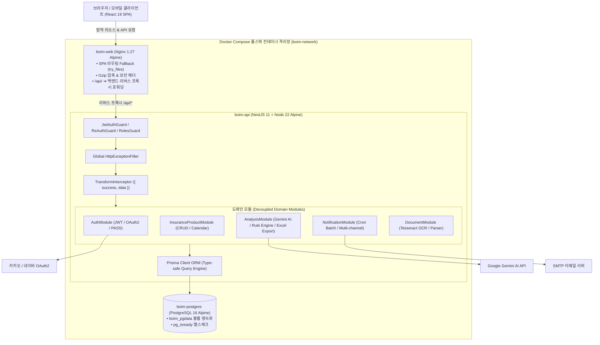
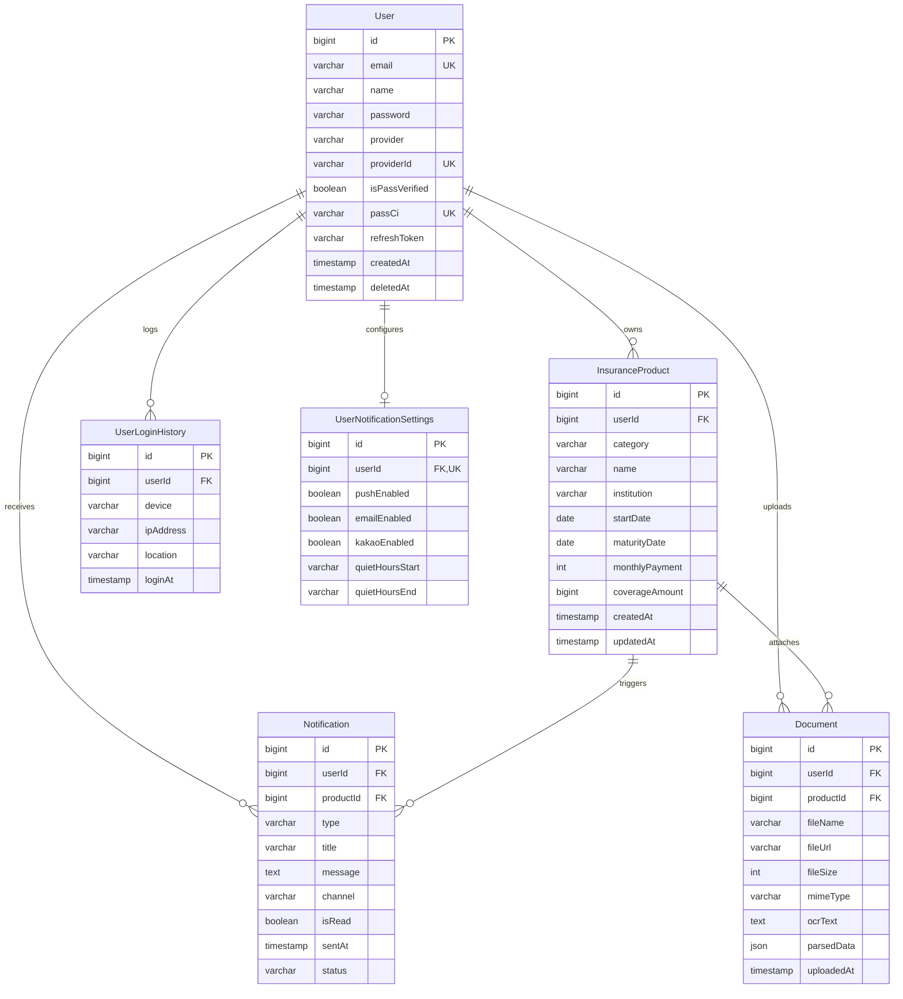

# ☂️ Boim (보임) - 개인 보험 가입 현황 관리 풀스택 플랫폼

> **"흩어진 내 보험, 한눈에 보임."**  
> 개인 보험 가입 현황 캘린더, 월 납입·만기 일정 자동 관리, Gemini AI 종합 보장 진단 및 Excel/PDF 리포트 출력을 제공하는 올인원 핀테크 풀스택 웹 애플리케이션입니다.

---

## 🌐 포트폴리오 데모 & 빠른 실행 (Quick Access)

| 구분 | 접속 및 실행 방법 | 설명 |
| :--- | :--- | :--- |
| **🚀 Live Web Demo** | **[`https://park-intae.github.io/Boim/`](https://park-intae.github.io/Boim/)** | 브라우저/스마트폰에서 클릭 한 번으로 토스 감성의 랜딩 페이지, 캘린더 인터랙션, AI 진단 리포트를 0.1초 만에 즉시 체험 |
| **📱 Mobile App (Expo)** | `cd apps/mobile && pnpm start` | Expo SDK 58 + React Native 기반 모바일 앱 (플로팅 탭 네비게이션 & 백엔드 실연동) |
| **🐳 Docker Full-Stack** | `git clone https://github.com/your-username/Boim.git && cd Boim` `docker compose up -d` | NestJS 11 백엔드 + PostgreSQL 16 DB + React 19 Nginx 웹서버를 단 한 줄의 명령어로 로컬에 즉시 기동 (`http://localhost`) |
| **📑 API Specification** | `http://localhost/api/docs` (로컬 기동 시) | NestJS Swagger 기반 RESTful API 엔드포인트 및 DTO 명세 확인 |

---

## 🏛️ 시스템 아키텍처 (Architecture Overview)

---

## 🗄️ 데이터베이스 모델링 (ERD)

---

## 🧪 전사 테스트 스위트 무결성 (Test Coverage & Integrity)

Boim 프로젝트는 기능 추가 및 리팩토링 시 **단 하나의 회귀 버그도 용납하지 않는 엄격한 테스트 주도 개발(TDD)**을 준수합니다.

| 영역 | 프레임워크 | 검증 항목 | 테스트 스위트 | 테스트 통과 수 | 통과율 |
| :--- | :--- | :--- | :---: | :---: | :---: |
| **Backend API** | Jest / Supertest | 컨트롤러, 서비스 비즈니스 로직, 인증/인가 가드, 크론 스케줄러, AI 진단 규칙 엔진 | **27 Suites** | **205 Tests** | **100% PASS** ✅ |
| **Frontend Web** | Vitest / Testing Library | 컴포넌트 렌더링, 캘린더 인터랙션, React Query 훅, Zustand 스토어, PWA 캐싱 | **48 Files** | **211 Tests** | **100% PASS** ✅ |
| **종합 무결성** | Turbo Monorepo | 모노레포 전체 통합 검증 (`pnpm test`) | **75 Suites** | **416 Tests** | **100% PASS** 🚀 |

---

## ⚙️ 백엔드 4대 핵심 비즈니스 엔진 (Core Backend Engines)

### 1. ⏰ 자정 자동 스케줄러 배치 엔진 (`@nestjs/schedule`)
- **자동 감지 로직:** 매일 자정(00:00 KST) 크론 배치를 통해 가입 보험의 **월 납입일(D-7, D-1)** 및 **만기일(D-30, D-7, D-Day)** 도래 대상을 고속 집계.
- **중복 발송 방지 (Idempotency):** 당일 동일 유저/동일 상품에 대한 중복 알림 생성 원천 차단.
- **야간 방해금지 시간 필터링:** 유저 설정(`UserNotificationSettings.quietHours`)을 준수하여 취침 시간대 외부 발송 억제.
- **탈착형 다중 채널 발송 파이프라인:** In-App(DB 영속 저장), Email(SMTP), Push, Kakao 채널 어댑터 패턴 적용.

### 2. 🧠 Google Gemini AI & 정밀 규칙 기반 하이브리드 진단 엔진
- **AI 종합 분석:** 사용자의 연령대(3040 기준) 및 가입 카테고리(실손, 암, 뇌/심장, 종신, 운전자 등)를 바탕으로 Google Gemini AI를 호출하여 종합 건강 점수(0~100점), 보장 등급, 강점, 보완점, 리모델링 조언 도출.
- **Rule-based 엔진 안전 폴백:** 외부 AI API 네트워크 장애 또는 할당량 초과 시, 사전에 정의된 알고리즘 규칙 엔진(`RuleBasedDiagnosisEngine`)으로 자동 전환되어 **무중단 100% 진단 결과** 보장.
- **데이터 내보내기 엔진:** 다중 시트 서식 적용 Excel(.xlsx) 리포트 생성(`exceljs`) 및 브라우저 원클릭 인쇄/PDF 저장 지원.

### 3. 📄 증권 자동 분석 및 패턴 매칭 엔진 (OCR & Rule Matcher)
- **Tesseract.js OCR & 텍스트 정제:** 업로드된 보험 증권 파일(PDF, 이미지, TXT)에서 텍스트 레이어를 정밀 추출.
- **정규식 기반 패턴 분석:** 국내 주요 보험사(삼성화재, 현대해상, DB손해보험, 한화생명 등)의 계약 패턴, 증권번호, 납입 주기, 만기일자, 보험료를 자동 파싱하여 프론트엔드 입력 폼에 원클릭 자동 입력(Prefill).

### 4. 🔒 엔터프라이즈 보안 및 인증 인프라
- **하이브리드 세션 관리:** 기기 기억하기(Remember Me) 토글에 따른 `sessionStorage` / `localStorage` 분기 스토리지 전략.
- **상용 소셜 OAuth2 통합:** 카카오 / 네이버 공식 REST API 연동 및 HMAC-SHA256 무상태 State 검증으로 CSRF 공격 차단.
- **PASS 본인인증 실감형 세션 파이프라인:** 6자리 일회용 암호화 난수, 180초 TTL 만료 타이머, 재전송 쿨다운 완비.
- **Row-level 권한 격리:** 모든 DB 쿼리 시 로그인된 본인의 데이터만 조회/수정 가능하도록 엄격한 인가 보장.

---

## 🛠️ 기술 스택 (Tech Stack)

| 구분 | 기술 스택 |
| :--- | :--- |
| **Frontend** | React 19, Vite, TypeScript, Tailwind CSS, TanStack Query, Zustand, React Hook Form, Zod, Lucide Icons, Recharts, oxlint |
| **Backend** | NestJS 11, Prisma ORM, PostgreSQL 16, Passport, JWT, bcrypt, Multer, Tesseract.js, `@nestjs/schedule`, `@google/genai`, `exceljs` |
| **DevOps & Infra** | Docker, Docker Compose, Multi-stage Dockerfile, Nginx 1.27 Alpine, GitHub Actions CI/CD Pipeline |
| **Architecture** | pnpm 워크스페이스 기반 모노레포 (`apps/web`, `apps/api`, `packages/shared-types`) |

---

## 🧪 테스트 계정 정보 (로컬 개발용)

개발 및 Docker 환경에서 로그인할 수 있는 기본 시드 계정입니다 (`apps/api/prisma/seed.ts` 자동 생성):
- **이메일**: `test@boim.com`
- **비밀번호**: `password123`

---

## 🚦 Phase 개발 마일스톤 현황

| Phase | 마일스톤 내용 | 상태 |
| :--- | :--- | :---: |
| **Phase 01~03** | 모노레포 구조화, 디자인 시스템 구축, SPA 3열 메인 레이아웃 | **완료** ✅ |
| **Phase 04~05** | 캘린더 연동 보험 CRUD, 내 보험 목록, 보험료 분석 차트, 알림/설정 패널 | **완료** ✅ |
| **Phase 06~08** | 반응형 모바일 전환, 전사 단위/통합 테스트 (100% Pass), 민감 작업 재인증(Re-Auth) | **완료** ✅ |
| **Phase 09** | 신규 회원가입, 간이 PASS 본인인증, 하이브리드 세션 관리, 소셜 연동 UI | **완료** ✅ |
| **Phase 10** | **보험 증권 파일 업로드 & 패턴 매칭 자동 분석 및 폼 자동 입력(Prefill)** | **완료** ✅ |
| **Phase 11** | **보험 만기 & 보험료 납입일 스케줄러 배치 및 다중 채널 알림 발송** | **완료** ✅ |
| **Phase 12** | **내 보험 가입 현황 AI 종합 진단 & 데이터 내보내기 (PDF / Excel 리포트)** | **완료** ✅ |
| **Phase 13** | **더미(Mock) 제거 & 실제 서비스 실연동 고도화 (대시보드 실집계, 다중 채널 알림, PASS 실감형 세션)** | **완료** ✅ |
| **Phase 14** | **프론트엔드 테스트 커버리지 80%+ 달성 및 Clean Architecture 컴포넌트/도메인 엔진 분리** | **완료** ✅ |
| **Phase 15** | **상용 소셜 OAuth2 (카카오 / 네이버) 실연동 및 1:N 다중 계정 연동/해제 파이프라인** | **완료** ✅ |
| **Phase 16** | **프론트엔드 번들 최적화(-90%), PWA 오프라인 캐싱, WAI-ARIA 및 Lighthouse 96/100/100/100 품질 고도화** | **완료** ✅ |
| **Phase 17** | **공개 서비스 소개 랜딩 페이지(Landing Page) 구현, 브랜드 로고 통일 및 인터랙션 고도화** | **완료** ✅ |
| **Phase 18** | **Docker 컨테이너화 및 GitHub Actions CI/CD 자동화 배포 파이프라인 (DevOps & Infrastructure)** | **완료** ✅ |
| **Phase 19** | **Expo(React Native) 기반 모바일 앱 구축, 플로팅 탭 네비게이션 및 실시간 인앱 OCR 오토 스캐너** | **완료** ✅ |
| **Phase 20** | **상용 외부 API 실연동 (Google Gemini AI 실시간 분석, 카카오/네이버 OAuth2 실연동 & 대표 본계정 파이프라인)** | **완료** ✅ |
| **Phase 21** | **프론트엔드 전수 Mock/더미 데이터 정리 및 실데이터 연동 무결성 검증 (Mock Cleanup & Real Data Binding)** | **완료** ✅ |

---

## 📋 패치노트 및 배포 운영 문서
- 상세 개발 패치 내역: **[`CHANGELOG.md`](./CHANGELOG.md)**
- 상용 배포 및 운영 가이드: **[`docs/DEPLOYMENT.md`](./docs/DEPLOYMENT.md)**
- 마스터 하네스 체크리스트: **[`.agents/Phase/Phase_harness.md`](./.agents/Phase/Phase_harness.md)**
