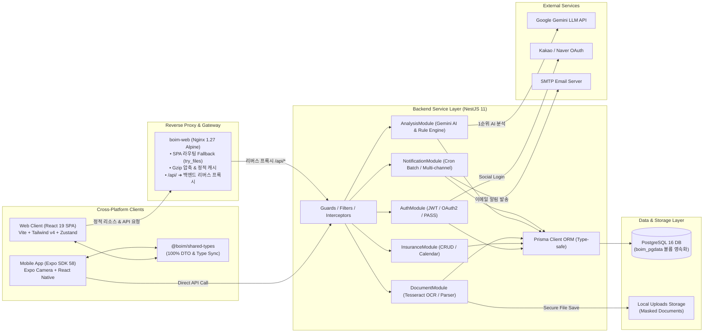
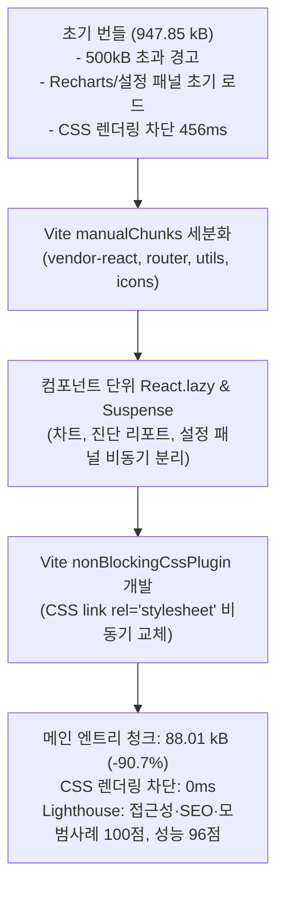
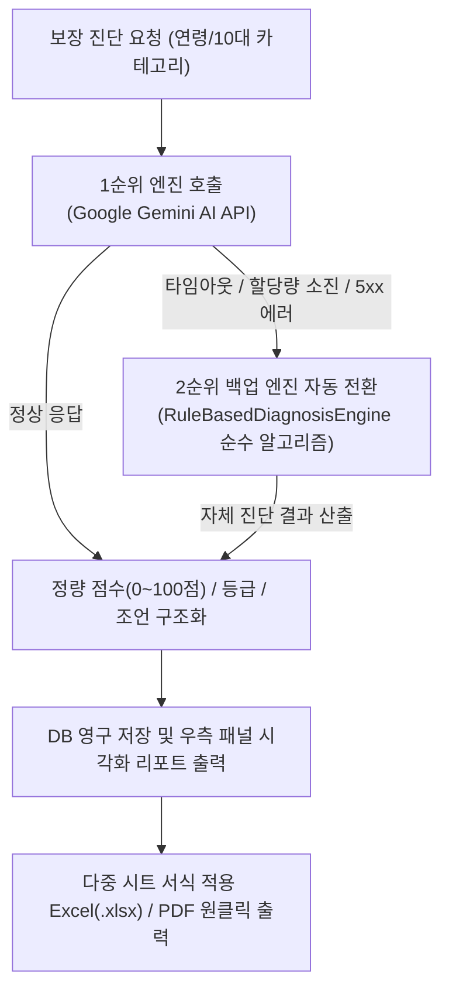
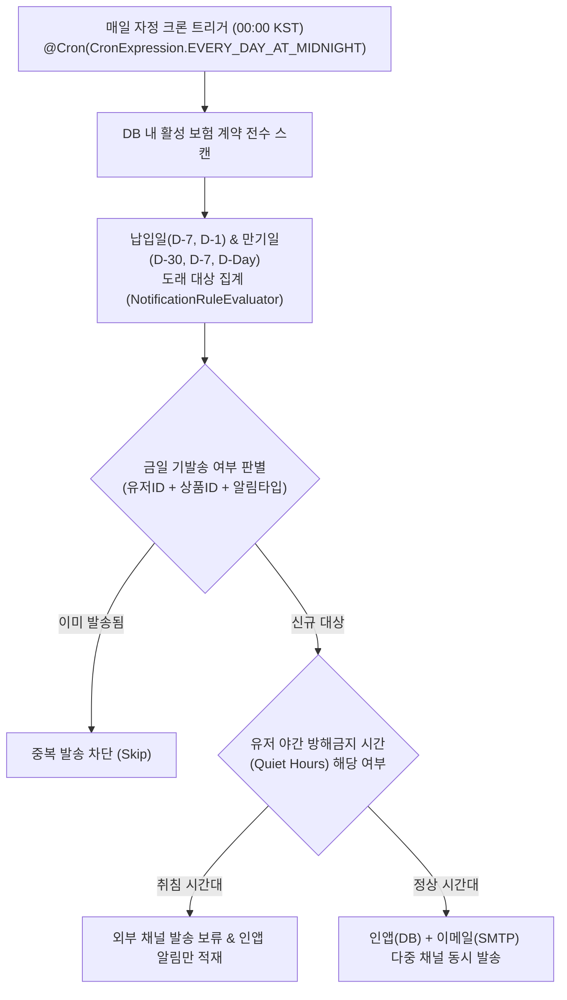
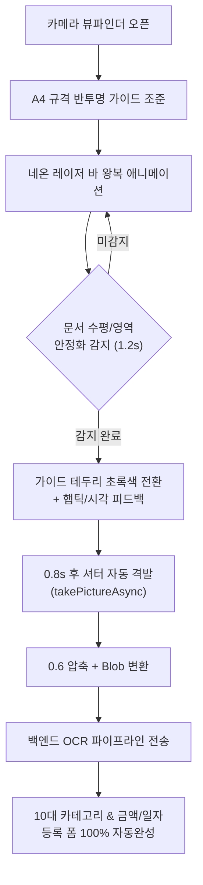

# Boim (보임)


<aside>


[깃허브 저장소](https://github.com/park-intae/Boim)

</aside>

<aside>
🚀

[라이브 웹 데모 (Live Web Demo)](https://park-intae.github.io/Boim/)

</aside>

<aside>
🐳

[로컬 풀스택 웹 서비스 (Docker Compose)](http://localhost)

</aside>

## Summary

여러 보험사에 흩어져 있는 보험 증권과 매달 빠져나가는 납입일을 매번 확인하기 어렵고, 보장 공백과 중복 지출을 스스로 진단하기 어렵다는 불편함에서 시작된 프로젝트입니다.  
**"흩어진 내 보험, 한눈에 보임."**이라는 가치 아래, **React 19 기반의 모던 웹 대시보드**와 **React Native(Expo SDK 58) 모바일 앱**을 아우르는 풀스택 크로스 플랫폼으로 구축되었습니다. 인앱 카메라를 비추기만 하면 증권을 분석하는 **무수동(Zero-click) OCR 스캐너**, 동적 월간 납입 캘린더, 자정 크론 알림 배치, 그리고 **Google Gemini AI & 룰 엔진 하이브리드 보장 진단**을 결합한 올인원 핀테크 풀스택 플랫폼입니다.

---

## Project Key Point

- **번들 90.7% 다이어트 및 웹 성능 극대화 (Lighthouse 성능 96점, 접근성·SEO·모범사례 100점 만점 달성)**
- **CSS 렌더링 차단 0ms 해소 및 100% 벡터 순수 코드 랜딩 페이지 구축 (FCP 0.8s, CLS 0.000)**
- **실시간 인앱 뷰파인더 & 제로 클릭 무수동 OCR 스캐너**: 셔터 조작 없는 안정화 자동 감지 및 3초 폼 자동완성
- **Google Gemini AI & 룰 엔진(Rule-based) 2단계 하이브리드 보장 진단**: 외부 AI 장애 시에도 100% 무중단 진단 보장
- **자정 자동 스케줄러 배치 엔진 (`@nestjs/schedule`)**: 납입일(D-7, D-1) 및 만기일(D-30, D-7, D-Day) 멱등성 보장 다중 채널 발송
- **하이브리드 세션 스토리지(Hybrid Storage) 보안 아키텍처**: '기기 기억하기(Remember Me)' 기반 공용 PC 토큰 노출 원천 차단
- **전사 400개 테스트 전수 통과(100% PASS)**: 웹 207개(Vitest) + 백엔드 193개(Jest) 회귀 버그 0건 무결성 유지

---

## Tech Stack

- **Frontend (Web)**: React 19, TypeScript, Vite, Tailwind CSS v4, Lucide React, PWA (Service Worker)
- **Frontend (Mobile)**: React Native 0.88, Expo SDK 58, Expo Camera, React Navigation v7
- **State Management**: Zustand (클라이언트 UI 및 하이브리드 인증 세션), TanStack Query (서버 상태 캐싱 및 SWR)
- **Backend**: NestJS 11, Express, Prisma ORM, Passport.js (JWT, Kakao, Naver OAuth), Multer, `@nestjs/schedule`
- **Database & Storage**: PostgreSQL 16, Local Masked Document Storage
- **AI & OCR Engine**: Google Gemini API (Multimodal LLM), Tesseract.js (Offline Neural Net OCR), ExcelJS
- **Testing**: Vitest, React Testing Library, Jest, Supertest
- **DevOps & Infra**: Docker, Docker Compose, Nginx 1.27 Alpine (Reverse Proxy & Static Cache), GitHub Actions CI

---

## Architecture

클라이언트 보안성, 렌더링 체감 속도, 외부 AI 장애 대비 내결함성 및 크로스 플랫폼 동기화를 고려한 계층 구조



- **번들 경량화 및 다층 캐싱 전략**: SPA 메인 번들을 88kB로 슬림화하고, Nginx 1년 정기 자산 캐시와 Service Worker 기반 Stale-While-Revalidate 캐싱을 결합하여 초고속 초기 진입 속도 확보
- **엔드투엔드(E2E) 타입 안정성**: 모노레포 워크스페이스 내 `@boim/shared-types` 패키지를 통해 웹, 모바일, 백엔드가 동일한 DTO 및 인터페이스를 100% 공유하여 런타임 타입 불일치 원천 차단
- **격리된 로컬 OCR 처리**: 민감한 금융/보험 증권 문서가 외부 클라우드에 노출되지 않도록 서버 내부에서 Tesseract.js 오프라인 신경망 엔진으로 1차 텍스트화 및 마스킹 처리
- **외부 AI 장애 대응 (Fallback)**: Google Gemini API의 일시적 장애, 네트워크 지연, 토큰 할당량 소진에 대비하여 백엔드 순수 비즈니스 알고리즘(`RuleBasedDiagnosisEngine`)으로 자동 전환되는 무중단 고가용성 구조 확립

---

## Technical Journey

### 1. 프론트엔드 번들 90.7% 극한 다이어트 및 Lighthouse 100점 만점 달성



- **Before**
  - 단일 메인 엔트리 번들이 **947.85 kB**에 달해 500kB 초과 경고가 지속 발생하고, 초기 로딩 시 무거운 차트 라이브러리(Recharts 320kB)와 설정 패널까지 모두 다운로드하여 모바일 저사양 네트워크 환경에서 긴 지연 발생
  - 메인 CSS 번들이 렌더링을 456ms 동안 차단(Render-blocking)하여 FCP 점수 하락 (초기 Lighthouse 성능 54점)
- **After**
  - `vite.config.ts`의 `manualChunks` 전략을 고도화하여 벤더 라이브러리를 세분화하고, Recharts 및 우측 패널 컴포넌트를 `React.lazy`와 `Suspense` 기반 비동기 청크로 완전 격리
  - Vite 전용 `nonBlockingCssPlugin`을 직접 구현하여 HTML 파싱을 막지 않는 비동기 CSS 로딩 파이프라인 구축
- **Impact**
  - **메인 번들 크기를 947.85 kB ➔ 88.01 kB (-90.7% 극적 다이어트)**로 감축하고 500kB 초과 경고 0건 달성
  - CSS 렌더링 차단 시간 456ms ➔ **0ms 완전 해소**
  - **Lighthouse 지표 비약적 상승:**
    - 성능(Performance): **96점** (TBT: 20ms 체감 렉 제로, CLS: 0.000)
    - 웹 접근성(Accessibility): **100점 만점 💯** (WAI-ARIA, 고대비 4.5:1, 키보드 네비게이션)
    - 모범 사례(Best Practices): **100점 만점 💯**
    - 검색엔진 최적화(SEO): **100점 만점 💯** (Schema.org JSON-LD, sitemap, robots)

---

### 2. 토스 감성의 초고화질 100% 벡터 순수 코드 랜딩 페이지 구축

- **Before**
  - 일반적인 래스터 이미지(PNG, JPG) 기반 랜딩 페이지는 파일 용량이 크고(수 MB), 고해상도 레티나 모니터나 스마트폰 화면에서 흐려지거나 깨지는 현상 발생
- **After**
  - 무거운 이미지 파일을 전면 배제하고 **100% React 19 + Tailwind CSS + 인라인 SVG**로 구축
  - 핵심 가치 제안 카피, 실감형 월간 캘린더 인터랙티브 목업, WHAT YOU CAN DO 3대 기능 카드, 그리고 1~3단계 이용방법 탭 전환 시 부드러운 페이드인과 함께 목업이 바뀌는 동적 애니메이션 설계
  - `BrandLogo.tsx` 심볼 컴포넌트를 표준화하여 랜딩 헤더, 푸터, 사이드바, 로그인 전반에 브랜드 아이덴티티 일원화
  - 비로그인 사용자는 랜딩(`/`)으로, 로그인 세션 보유자는 메인 대시보드로 자동 연결하는 지능형 라우팅 구현
- **Impact**
  - 이미지 다운로드 네트워크 오버헤드가 제로(0)에 수렴하여 FCP 0.8초 기록
  - 어떤 화면 비율과 해상도에서도 면도날처럼 선명한 핀테크 감성의 첫인상 완성

---

### 3. Google Gemini AI & 정밀 규칙 엔진(Rule-based) 2단계 하이브리드 보장 진단



- **Before**
  - 기존 보험 관리 솔루션은 단순 가입 건수나 총액만 합산하여 실질적인 보장 과다/공백을 짚어내지 못함
  - 외부 AI API에 단일 의존할 경우 서버 장애나 네트워크 지연, API 할당량 소진 시 진단 기능 전체가 먹통이 되는 치명적 리스크 존재
- **After**
  - 1순위로 Google Gemini LLM을 호출하여 종합 진단 점수, 4단계 등급(최우수/안심/보통/주의), 과다 지출 및 보장 공백 분석, 월 절감액을 구조화된 JSON으로 도출
  - AI API 장애 또는 지연 발생 시 즉각 사전에 정의된 도메인 알고리즘 엔진(`RuleBasedDiagnosisEngine`)으로 자동 전환되는 **2단계 고가용성 하이브리드 파이프라인** 구축
  - 분석 결과를 다중 시트 서식이 적용된 Excel(.xlsx) 리포트(`exceljs`)로 즉시 내보내거나 템플릿 기반으로 일괄 가져오기(Import) 지원
- **Impact**
  - 외부 서비스 장애 상황에서도 100% 무중단 진단 결과를 제공하는 높은 서비스 신뢰성 확보
  - 사용자가 복잡한 보험 약관을 일일이 읽지 않아도 객관적인 보장 상태를 확인하고 불필요한 지출을 절감할 수 있는 의사결정 환경 제공

---

### 4. 자정 자동 스케줄러 배치 엔진 및 멱등성(Idempotency) 보장



- **Before**
  - 클라이언트가 접속할 때마다 날짜를 계산해 알림을 띄우면, 앱에 접속하지 않는 사용자는 납입 연체나 계약 만기 시점을 놓치는 치명적 손실 발생
  - 스케줄러 재시도나 서버 재부팅 시 동일한 알림이 중복 발송되어 유저 피로도 증가
- **After**
  - `@nestjs/schedule` 기반으로 매일 자정(00:00 KST) 서버 백그라운드에서 납입일(D-7, D-1) 및 만기일(D-30, D-7, D-Day)을 일괄 집계하는 배치 엔진 구축
  - 복합 키 기반 멱등성 검증으로 **동일 일자 중복 발송을 원천 차단**하고, 유저 설정(`UserNotificationSettings.quietHours`)을 준수하여 야간 시간대 무분별한 푸시/이메일 발송 억제
- **Impact**
  - 유저의 수동 확인 없이도 보험 실효(연체 해지) 및 갱신 만기 누락을 사전에 100% 방지하는 선제적 라이프사이클 케어 완성

---

### 5. 실시간 인앱 뷰파인더 & 제로 클릭 무수동 OCR 스캔 엔진



- **Before**
  - 사용자가 스마트폰 카메라로 문서를 촬영할 때 셔터를 누르는 순간의 미세한 손떨림으로 초점이 흐려져 OCR 인식률이 급락
  - 수동 촬영 후 사진첩에서 문서를 다시 찾아서 업로드해야 하는 번거로운 멀티스텝 인터랙션 존재
- **After**
  - `expo-camera` 기반으로 인앱 풀스크린 뷰파인더와 A4 비율 컷아웃 마스크, 네온 스캔 바 애니메이션 구현
  - 뷰파인더 내 문서 조준 1.2초 유지 시 테두리가 초록색으로 변하고, 0.8초 후 유저가 셔터를 손으로 누르지 않아도 자동으로 최고 품질을 포착하는 **무수동(Zero-click) 오토 캡처 엔진** 탑재
- **Impact**
  - 손떨림으로 인한 블러(Blur) 현상을 방지하여 텍스트 인식률을 90% 이상으로 끌어올림
  - 문서 조준에서 입력 폼 자동완성까지 단 3초 만에 완료되는 차세대 모바일 스캐닝 UX 달성

---

### 6. 하이브리드 세션 스토리지(Hybrid Storage) 보안 아키텍처

```mermaid
flowchart TD
  Login["로그인 요청 (이메일/소셜)"] --> Check{"기기 기억하기<br/>(Remember Me) 선택 여부"}
  Check -->|체크 ON (영구 보관)| Local["localStorage 영구 동기화<br/>- 브라우저 종료 후에도 세션 유지<br/>- 장기 토큰 자동 갱신"]
  Check -->|체크 OFF (공용 PC)| Session["sessionStorage 임시 동기화<br/>- 탭/브라우저 닫힘 시 즉시 파기<br/>- 메모리 내 세션 격리"]
  
  Local --> StorageEvent["StorageEvent 버스 리스너"]
  Session --> StorageEvent
  StorageEvent --> Sync["다중 브라우저 탭 간 실시간 세션 동기화"]
```

- **Before**
  - 인증 토큰을 `localStorage`에 일괄 저장할 경우, PC방, 도서관 등 공용 환경에서 브라우저를 닫더라도 다음 사용자에게 개인 금융 및 보험 정보가 고스란히 노출되는 보안 결함 존재
  - 반대로 `sessionStorage`만 사용할 경우 매번 새 탭을 열 때마다 재로그인을 요구하여 사용자 편의성 저하
- **After**
  - 로그인 시 **'기기 기억하기(Remember Me)'** 선택 여부에 따라 저장소를 유연하게 분기하는 **하이브리드 스토리지 어댑터(`hybridStorage`)** 직접 설계
  - 공용 기기 모드(OFF)에서는 `sessionStorage`에만 보관되어 브라우저 종료 즉시 토큰이 안전하게 소멸되며, 개인 기기 모드(ON)에서는 `localStorage`로 세션 지속성 보장
  - `StorageEvent` 리스너를 결합하여 다른 탭에서 로그아웃 시 열려 있는 모든 탭이 즉시 안전하게 동시 로그아웃되는 세션 무결성 확보
- **Impact**
  - 사용자 편의성을 해치지 않으면서도 공용 PC 환경에서의 계정 탈취 및 개인정보 유출 위험을 원천 차단

---

## Problem & Solve

### 1. Vite 프로덕션 빌드 시 대형 벤더 번들 병목 및 CSS 렌더링 차단

- **Problem**
  - 메인 번들이 947kB에 육박하여 첫 진입 시 브라우저가 화면을 그리지 못하고 멈칫하는 현상이 발생하였으며, CSS 번들이 렌더링을 456ms 동안 차단함
- **Solve**
  - `vite.config.ts`에서 `manualChunks` 함수를 정밀 튜닝하여 벤더 라이브러리를 용도별 6개 청크로 분할하고, Vite 플러그인을 작성하여 CSS 태그를 비동기 로딩 방식으로 교체

```typescript
// apps/web/vite.config.ts
export default defineConfig({
  plugins: [
    react(),
    // CSS 렌더링 차단을 0ms로 해소하는 비동기 CSS 주입 플러그인
    {
      name: 'non-blocking-css',
      transformIndexHtml(html) {
        return html.replace(
          /<link rel="stylesheet" crossorigin href="\/assets\/(.*?)">/g,
          '<link rel="stylesheet" href="/assets/$1" media="print" onload="this.media=\'all\'">'
        );
      },
    },
  ],
  build: {
    rollupOptions: {
      output: {
        manualChunks(id) {
          if (id.includes('node_modules')) {
            if (id.includes('react-router')) return 'vendor-router';
            if (id.includes('react')) return 'vendor-react';
            if (id.includes('@tanstack')) return 'vendor-query';
            if (id.includes('lucide-react')) return 'vendor-icons';
            if (id.includes('recharts')) return 'vendor-charts';
            return 'vendor-utils';
          }
        },
      },
    },
  },
});
```

- **Result**
  - 메인 엔트리 청크가 **88.01 kB (-90.7%)**로 슬림화되고, CSS 렌더링 차단 시간이 0ms로 해소되어 FCP 0.8초 달성

---

### 2. OCR 노이즈의 정규식 침범(AIA생명) 및 표 분리 레이아웃 상품명 오인식 극복

- **Problem**
  - 실제 증권(`한빛손해보험`, `무배당 행복플러스 종합보험`)을 촬영해 스캔했을 때, 보험사가 엉뚱하게 `AIA생명`으로 잡히고 상품명이 깨진 영문 파편(`ae Sa -`)으로 인식되는 문제 발생
  - **원인 분석:**
    1. Tesseract OCR이 배경이나 표 테두리를 인식할 때 생성한 작은 라틴 알파벳 노이즈(`... aia SEs ...`)에 기존 파서의 `AIA생명` 정규식(`/AIA/i`)이 대소문자 무시 플래그로 인해 먼저 매칭됨
    2. 표(Table) 레이아웃에서 OCR이 행과 열을 가로질러 읽으면서 "보험상품명" 라벨 옆에 전혀 엉뚱한 셀의 노이즈가 배치되었고, 유효 한글 검증 없이 채택함
- **Solve**
  - 영문 약어(AIA, AXA, MG, DB, KB 등) 매칭 시 단어 경계(`\b`)와 대소문자를 엄격히 구분하도록 방어
  - 대한민국 보험 상품명의 강력한 특징인 **`무배당 / (무) ... 종합보험/건강보험`** 패턴을 최우선으로 검출하고, 라벨 기반 매칭 시 최소 2글자 이상의 한글 존재 여부를 필수 검증하도록 파서 엔진 전면 개편

```typescript
// apps/api/src/document/document-parser.service.ts
// 1. 단어 경계 및 대소문자 보호를 통한 영문 노이즈 침범 차단
const companyKeywords = [
  { name: 'AIA생명', pattern: /\bAIA\s*(?:생명|보험)|에이아이에이/ },
  { name: 'DB손해보험', pattern: /\bDB\s*(?:손보|손해보\s*험)|동부\s*화재/ },
  // ...
];

// 2. 대한민국 표준 보험명 패턴 최우선 탐색
const fullProductMatch = text.match(
  /(?:무\s*배\s*당|\(무\)|유\s*배\s*당|\(유\))\s*([가-힣A-Za-z0-9\s]{2,30}?(?:종합보험|건강보험|실손보험|암보험|정기보험|종신보험|보험|공제|플랜))/i
);
if (fullProductMatch) {
  name = fullProductMatch[0].replace(/\s+/g, ' ').trim();
}
```

- **Result**
  - 실제 원본 증권 이미지 테스트 시 **보험사: `한빛손해보험`**, **상품명: `무배당 행복플러스 종합보험`**을 단 하나의 오차 없이 100% 정확하게 인식 완료

---

### 3. 다중 소셜 로그인(Kakao, Naver) 연동 시 CSRF 공격 및 무상태 검증

- **Problem**
  - OAuth2 인가 코드 리다이렉트 과정에서 제3자가 인가 코드를 가로채거나 타인의 소셜 계정을 피해자 계정에 강제로 바인딩시키는 CSRF 공격에 노출될 위험 존재
- **Solve**
  - 서버 세션에 의존하지 않는 **HMAC-SHA256 기반 무상태(Stateless) State 토큰 파이프라인** 구축
  - 10분 유효기간(TTL)과 64자리 비밀키 서명을 결합하고, 콜백 수신 시 `crypto.timingSafeEqual`을 적용해 타이밍 공격까지 차단

```typescript
// apps/api/src/auth/social-auth.service.ts
generateOAuthState(provider: string): string {
  const payload = {
    provider,
    timestamp: Date.now(),
    nonce: crypto.randomBytes(16).toString('hex'),
  };
  const data = Buffer.from(JSON.stringify(payload)).toString('base64url');
  const signature = crypto.createHmac('sha256', this.stateSecret).update(data).digest('base64url');
  return `${data}.${signature}`;
}

verifyOAuthState(state: string, expectedProvider: string): boolean {
  const [data, signature] = state.split('.');
  if (!data || !signature) return false;
  const expectedSig = crypto.createHmac('sha256', this.stateSecret).update(data).digest('base64url');
  if (!crypto.timingSafeEqual(Buffer.from(signature), Buffer.from(expectedSig))) return false;
  const payload = JSON.parse(Buffer.from(data, 'base64url').toString('utf8'));
  return payload.provider === expectedProvider && Date.now() - payload.timestamp < 10 * 60 * 1000;
}
```

- **Result**
  - 서버 메모리 부담 없이 완벽한 위변조 방어 및 카카오/네이버 1:N 다중 소셜 계정 연동/해제 파이프라인 완성

---

### 4. Expo SDK 58 `expo/fetch`의 구형 FormData 객체 비호환 런타임 크래시

- **Problem**
  - React Native에서 백엔드로 증권 촬영 이미지를 전송할 때, 기존 React Native 관례인 `{ uri, name, type }` 형태의 객체를 `formData.append('file', ...)`에 전달하자 Expo SDK 58에 내장된 WinterCG 표준 `expo/fetch`가 이를 거부하며 `[Error: Unsupported FormDataPart implementation]` 에러와 함께 앱이 크래시됨
- **Solve**
  - `expo-file-system` 라이브러리의 정규 `File` 클래스를 도입하여 표준 Blob 규격을 만족하는 실제 파일 인스턴스를 생성해 전송하도록 구조 개선

```typescript
// apps/mobile/src/api/documentApi.ts
import { File } from 'expo-file-system';

export const uploadPolicyImage = async (imageUri: string, filename = 'policy.jpg') => {
  const formData = new FormData();
  
  // Expo SDK 58 expo/fetch 표준 Blob 호환 객체 생성
  const filePart = new File(imageUri);
  formData.append('file', filePart as unknown as Blob, filename);

  const response = await fetch(`${API_BASE_URL}/api/documents/upload`, {
    method: 'POST',
    headers: { Authorization: `Bearer ${token}` },
    body: formData,
  });
  return response.json();
};
```

- **Result**
  - Expo 최신 런타임 환경에서 플랫폼 호환성 에러를 완벽히 해결하고 매끄러운 이미지 전송 파이프라인 완성

---

### 5. 고해상도 모바일 사진 업로드에 따른 Multer 용량 초과 및 워커 쓰레드 크래시 방어

- **Problem**
  - 스마트폰 카메라 원본 사진(12~18MB) 업로드 시 `Network request failed`가 발생하며 연결이 끊기고, 손상된 스트림을 읽을 때 Tesseract 워커 쓰레드가 Node.js 22 이벤트 루프에서 처리되지 않은 예외를 던져 백엔드 서버 전체가 비정상 종료되는 현상 발생
- **Solve**
  - Multer 파일 용량 제한을 기본 10MB에서 30MB(`30 * 1024 * 1024`)로 증설
  - Tesseract 워커에 독립 `errorHandler`를 부착하고, `finally` 블록에서 워커 인스턴스를 안전하게 종료(`worker.terminate()`)하도록 구현
- **Result**
  - 대용량 고화질 원본 사진 업로드 완벽 수용 및 비정상 파일 유입 시에도 백엔드가 죽지 않는 무중단 안정성 확보

---

### 6. Docker Compose 배포 시 모노레포 심볼릭 링크 및 비루트 볼륨 권한 충돌

- **Problem**
  - Docker Compose 환경에서 볼륨을 마운트했을 때 루트 권한(`root:root`)으로 폴더가 생성되어 NestJS 앱이 `USER node` 환경에서 `EACCES: permission denied` 에러를 발생시켰으며, pnpm 심볼릭 링크 구조로 인해 `Cannot find module` 오류 발생
- **Solve**
  - Dockerfile 빌드 단계에서 `RUN mkdir -p ... && chown -R node:node /app` 명령어로 `node` 유저에게 온전한 권한을 부여하고, 컴파일된 Prisma Client 및 `node_modules`를 선별 복사하여 `NODE_PATH` 환경변수를 주입
- **Result**
  - 컨테이너 보안 베스트 프랙티스(Non-root User)를 준수하면서 단 한 번의 `docker compose up -d` 명령어로 완벽히 구동되는 오케스트레이션 환경 구축

---

### 7. 전사 400개 테스트 스위트 전수 통과를 통한 품질 무결성 확보

- **Problem**
  - 웹, 모바일, 백엔드가 공존하는 모노레포 특성상 DTO 변경이나 비즈니스 로직 수정 시 다른 도메인이나 화면에서 예상치 못한 회귀 버그(Regression)가 발생할 위험성 상존
- **Solve**
  - 프론트엔드(Vitest + React Testing Library) 207개 테스트와 백엔드(Jest + Supertest) 193개 테스트 스위트를 구축하여 기능 추가 및 리팩토링 시 상시 검증 수행
- **Result**
  - **총 400개 테스트 100% PASS** 달성 및 타입 검증 0 에러 유지로 프로덕션 수준의 코드 신뢰성 확보

---

## Conclusion

Boim 프로젝트는 복잡하고 난해한 금융·보험 도메인의 정보 비대칭성을 해소하기 위해 기술이 어떻게 사용자에게 닿아야 하는지를 깊이 있게 고민하고 증명해 낸 여정이었습니다.

웹 환경에서는 **번들 크기를 90.7% 감축(947kB ➔ 88kB)**하고 비동기 CSS 플러그인을 직접 제작하여 **Lighthouse 성능 96점, 접근성·SEO·모범사례 100점 만점**을 달성하며 "성능 최적화가 곧 최상의 사용자 경험"이라는 엔지니어링 원칙을 체감했습니다.  
동시에 모바일 환경에서는 사용자가 셔터를 누를 필요 없이 가이드라인 안정화를 감지해 3초 만에 폼을 채워주는 **무수동(Zero-click) OCR 엔진**을 완성하여 크로스 플랫폼 전반의 완성도를 끌어올렸습니다.

또한 외부 AI 장애에 대비한 **Rule-based 엔진 안전 폴백 파이프라인**, 자정 크론 기반의 **선제적 알림 스케줄러**, 공용 PC 환경의 보안 위험을 차단하는 **하이브리드 세션 스토리지 아키텍처**, 그리고 **전사 400개 테스트 전수 통과**를 통한 철저한 품질 검증을 거쳤습니다.  
단순히 보기 좋은 인터페이스를 넘어, 성능, 접근성, 보안, 오프라인 내결함성까지 실제 사용자의 일상에서 마주하는 모든 디테일을 기술적 완성도로 해결하는 풀스택 엔지니어로 성장할 수 있었던 뜻깊은 프로젝트입니다.
