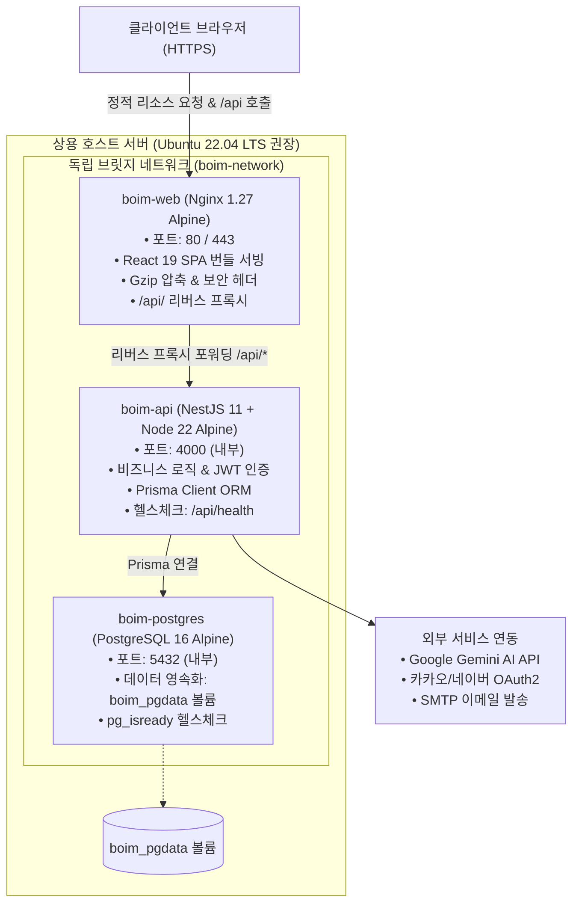

# 🚢 Boim 상용 서버 배포 및 운영 가이드 (Production Deployment Guide)

본 문서는 Boim 풀스택 서비스(NestJS 11 백엔드, React 19 프론트엔드/Nginx, PostgreSQL 16)를 실제 상용 클라우드 환경(AWS EC2, GCP Compute Engine, On-premise Linux 등)에 안전하고 신속하게 배포 및 운영하기 위한 표준 가이드입니다.

---

## 🏗️ 1. 상용 배포 시스템 아키텍처



---

## 📋 2. 사전 요구사항 및 인프라 권장 사양

### 권장 서버 사양
- **운영체제:** Ubuntu 22.04 LTS / Debian 12
- **CPU:** 2 Core 이상 (멀티스테이지 Docker 빌드 시 4 Core 권장)
- **메모리(RAM):** 최소 2GB 이상 (권장 4GB 이상)
- **디스크:** 최소 20GB SSD 여유 공간

### 필수 설치 소프트웨어
```bash
# Docker Engine 및 Docker Compose 플러그인 설치 확인
docker --version         # Docker version 24.0.0 이상 권장
docker compose version   # Docker Compose version v2.20.0 이상 권장
git --version            # Git 2.30.0 이상
```

### 방화벽(UFW / Security Group) 인바운드 규칙
| 포트 | 프로토콜 | 용도 | 공개 여부 |
| :--- | :--- | :--- | :--- |
| `22` | TCP | SSH 원격 접속 | 관리자 IP만 허용 권장 |
| `80` | TCP | HTTP 웹 접근 (Certbot 인증 및 HTTPS 리다이렉트) | 전체 공개 (`0.0.0.0/0`) |
| `443` | TCP | HTTPS 보안 웹 접근 (상용 서비스) | 전체 공개 (`0.0.0.0/0`) |
| `4000` | TCP | 백엔드 API 직접 접근 | **비공개** (Nginx 리버스 프록시 경유) |
| `5432` | TCP | PostgreSQL 데이터베이스 | **비공개** (도커 내부 네트워크만 허용) |

---

## 🚀 3. 단계별 배포 절차 (Step-by-Step)

### Step 1: 저장소 클론 및 브랜치 체크아웃
```bash
# 프로젝트 저장소 클론
git clone https://github.com/your-org/Boim.git /var/www/boim
cd /var/www/boim

# 상용 배포 브랜치 이동 (예: master 또는 main)
git checkout master
git pull origin master
```

### Step 2: 상용 환경 변수 파일 생성 및 보안 설정
```bash
# 템플릿 파일을 상용 환경 변수 파일(.env.production)로 복사
cp .env.production.example .env.production

# 파일 권한을 소유자 전용(600)으로 제한하여 권한 탈취 방지
chmod 600 .env.production

# 환경 변수 편집기를 열어 실제 운영 비밀키 입력
nano .env.production
```

> [!CAUTION]
> - `POSTGRES_PASSWORD`와 `JWT_SECRET`은 무작위 난수(`openssl rand -hex 64`)로 반드시 변경하십시오.
> - `USE_MOCK_PARSER=false` 및 유효한 `GEMINI_API_KEY`를 설정하여 실감형 AI 진단 엔진이 가동되도록 하십시오.
> - 소셜 로그인(카카오, 네이버)의 `CALLBACK_URL` 도메인이 실제 서비스 도메인과 일치하는지 확인하십시오.

### Step 3: Docker Compose 원클릭 빌드 및 백그라운드 기동
```bash
# 상용 환경 변수를 지정하여 3대 서비스 컨테이너 빌드 및 기동
docker compose --env-file .env.production up -d --build
```

### Step 4: 데이터베이스 스키마 마이그레이션 적용
컨테이너 기동 완료 후, PostgreSQL 데이터베이스에 최신 Prisma 스키마를 안전하게 반영합니다.
```bash
# api 컨테이너 내부에서 prisma migrate deploy 실행
docker compose exec api pnpm exec prisma migrate deploy
```

---

## 🔍 4. 서비스 상태 점검 및 무결성 검증

### 1) 컨테이너 상태 점검
```bash
docker compose ps
```
출력 결과에서 아래 3대 컨테이너의 상태를 확인합니다:
- `boim-postgres`: `Up ... (healthy)`
- `boim-api`: `Up ...`
- `boim-web`: `Up ...`

### 2) 헬스체크 엔드포인트 응답 확인
```bash
# 호스트 Nginx 리버스 프록시를 경유한 헬스체크
curl -i http://localhost/api/health

# 기대 출력:
# HTTP/1.1 200 OK
# Content-Type: application/json; charset=utf-8
# {"success":true,"data":"Boim API Server is running!"}
```

### 3) 실시간 컨테이너 로그 모니터링
```bash
# 전체 서비스 로그 실시간 확인
docker compose logs -f

# 특정 서비스 로그 확인
docker compose logs -f api
docker compose logs -f web
docker compose logs -f postgres
```

---

## 🔄 5. 무중단 롤링 업데이트 및 롤백 가이드

### 새 버전 업데이트 배포 (Rolling Deployment)
```bash
# 1. 최신 코드 가져오기
git pull origin master

# 2. 백엔드/프론트엔드 신규 이미지 사전 빌드
docker compose --env-file .env.production build

# 3. DB 마이그레이션 선반영 (필요 시)
docker compose exec api pnpm exec prisma migrate deploy

# 4. 서비스 순차 재기동 (다운타임 최소화)
docker compose --env-file .env.production up -d --no-deps api
docker compose --env-file .env.production up -d --no-deps web
```

### 긴급 롤백(Rollback) 절차
배포 직후 치명적인 오류가 발생한 경우 이전 안정 커밋으로 신속하게 롤백합니다:
```bash
# 이전 안정 커밋 태그 또는 해시로 복구
git reset --hard <PREVIOUS_COMMIT_HASH>

# 이전 코드로 즉시 재빌드 및 재기동
docker compose --env-file .env.production up -d --build
```

---

## 🔒 6. 상용 SSL/TLS (HTTPS) 연동 권장 방안

상용 서비스에서는 사용자 개인정보 및 인증 토큰 보호를 위해 **HTTPS** 적용이 필수입니다.

### 호스트 Nginx + Certbot 활용 권장 (가장 안정적인 방식)
1. 호스트 OS에 Nginx 및 Certbot 설치:
   ```bash
   sudo apt update && sudo apt install -y nginx certbot python3-certbot-nginx
   ```
2. 호스트 Nginx 설정에서 `http://localhost:80` (Docker web 컨테이너)로 프록시 패스 지정.
3. Let's Encrypt 무료 SSL 인증서 자동 발급:
   ```bash
   sudo certbot --nginx -d boim.yourdomain.com
   ```
4. 자동 갱신 크론탭 등록 확인 (`certbot renew --dry-run`).
