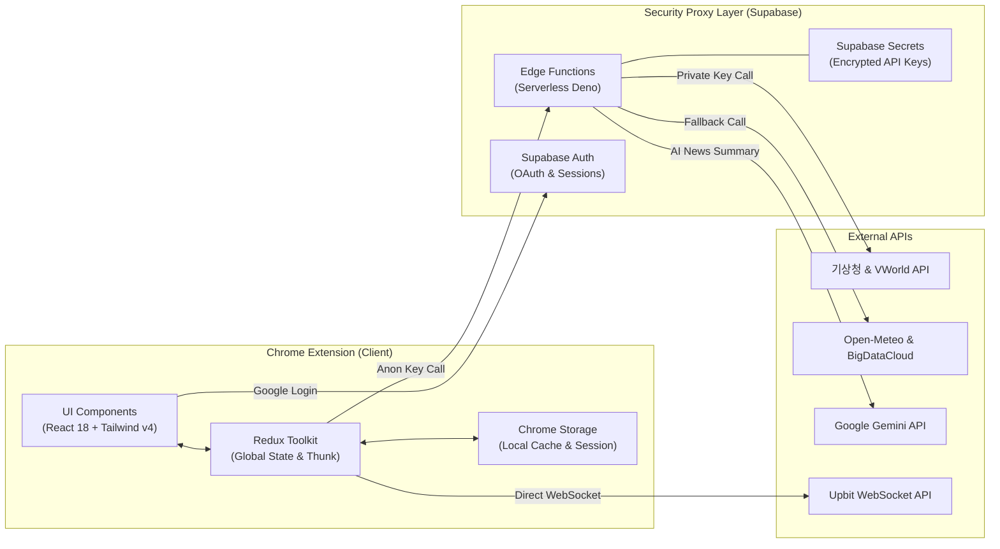
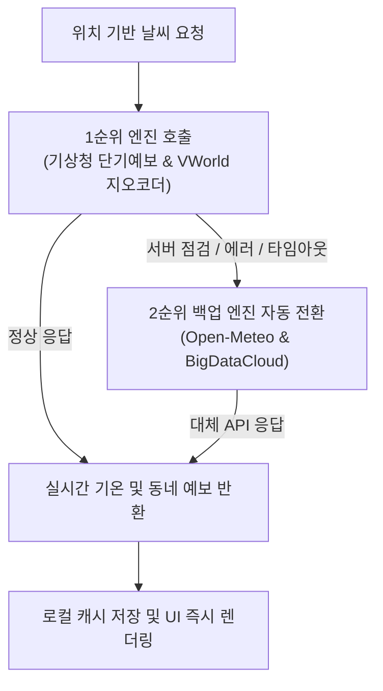
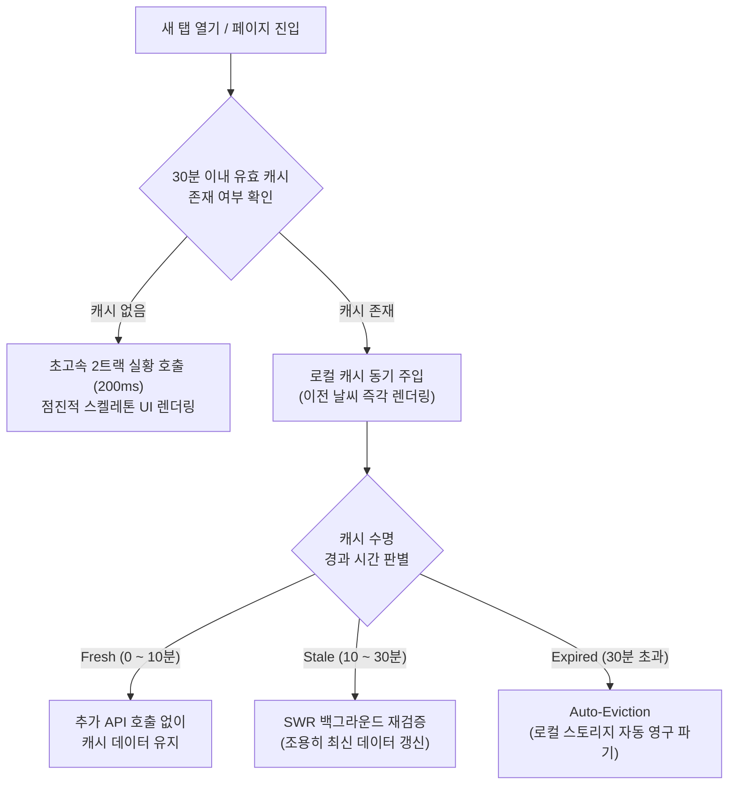

# DoorFrame


<aside>


[깃허브](https://github.com/park-intae/doorframe)

</aside>

<aside>
🎨

[디자인](https://www.figma.com/design/2DgnkpYFiF0Wdthn2SnBqH/DoorFrame?node-id=0-1&t=1K7os0y2phmpqJnh-0)

</aside>

## Summary

자주 사용하는 정보(날씨, 뉴스, 코인 시세)를 매번 여러 탭을 열어 확인하던 불편함에서 시작해, 크롬 새 탭에서 개인화된 정보를 한눈에 소비할 수 있는 대시보드 플랫폼으로 발전시킨 프로젝트입니다.

## Project Key Point

- 로컬 스토리지 동기 캐시 주입 및 30분 SWR 패턴 설계로 **새 탭 진입 시 스켈레톤 깜빡임 없는 즉각 렌더링 구현**
- SSR → CSR 전환 및 리소스 최적화를 통한 **렌더링 성능 극대화 (Lighthouse 98점 달성)**
- Supabase Edge Functions API 중계 구축으로 **클라이언트 번들 내 민감 API 키 격리**
- 공공 기상 API 장애에 대비한 대체 API(Open-Meteo) 및 LLM 모델 폴백 구조로 **서비스 안정성 확보**
- 커스텀 브레이크포인트와 상하 제스처를 결합한 **데스크탑 2열 반응형 대시보드 구현**

## Tech Stack

- **Frontend**: React, TypeScript, Vite (CSR 구조), Tailwind CSS, Framer Motion, Chart.js
- **State Management**: Redux Toolkit
- **Backend**: Supabase (Edge Functions, Auth, Storage)
- **Testing**: Vitest, React Testing Library
- **External API**: 기상청 공공 데이터 API / VWorld 지오코드 API / Open-Meteo API / Gemini API / Upbit API

## Architecture

클라이언트 보안성, 렌더링 체감 속도 및 서비스 안정성을 고려한 계층 구조



- **API 키 격리 및 중계 (Edge Functions)**: Supabase Edge Functions를 중계 서버로 두어 클라이언트 소스코드에 민감 API 키(기상청, Gemini 등)가 노출되지 않도록 안전하게 분리
- **캐시 동기 주입 및 렌더링 최적화**: 로컬 스토리지 캐시 동기 주입과 30분 수명 주기 기반 SWR 패턴을 설계하여 새 탭 오픈 시 로딩 깜빡임 없이 이전 데이터를 즉시 렌더링
- **외부 API 장애 대응 (Fallback)**: Redux Toolkit 기반으로 전역 상태 흐름을 단방향 일원화하고, 공공 API 장애 및 점검 시 대체 기상 API(Open-Meteo)로 자동 전환되는 안정적인 데이터 파이프라인 구축

## Technical Journey

### 1. 실시간 코인 시세 정보 제공 및 웹소켓 연결 최적화

- Before
    - 컴포넌트 라이프사이클마다 개별 웹소켓 연결이 발생해 불필요한 핸드셰이크가 반복되고, 재렌더링 시 연결 끊김 및 외부 거래소 서버의 다중 연결 거부 위험 존재
- After
    - 싱글톤(Singleton) 공유 웹소켓 인스턴스 및 발행-구독(Pub/Sub) 패턴을 설계하여 단일 소켓 파이프라인으로 일원화
    - 수신 데이터에 대한 Null Safety 방어 코드 및 시세 등락에 따른 실시간 동적 스타일링 적용
- Impact
    - 불필요한 중복 소켓 연결을 최소화하고 컴포넌트 언마운트/재렌더링 시에도 안정적인 실시간 시세 스트리밍 환경 구축
    - 실시간 변동률(%) 및 변동액에 대한 직관적인 시각적 피드백 제공

### 2. 날씨 데이터 고도화

- Before
    - 현재 시간 기준 초단기 예보 데이터만 제공해 정보 제공량이 부족
    - 데이터 시각화를 현재 날씨 정보 폰트를 볼드로만 처리하는 한계가 존재
- After
    - 데이터 파이프라인 재설계를 통해 단기/초단기 예보로 제공하는 정보량 확장
    - 기온 변화를 그래프로 제공해 변화량을 직관적으로 제공
    - 최고기온, 최저기온, 강수확률 데이터에 글씨 색과 툴팁을 적용
- Impact
    - 제공하는 데이터 범주 확장을 통해 정보 밀집성 향상
    - 변동 데이터에 대한 시각화를 통해 사용자의 직관적 데이터 인지 환경 제공

### 3. 보안 프록시 계층 도입으로 보안성 강화

- Before
    - 외부 API를 프론트엔드 클라이언트 번들에서 직접 호출
    - Chrome 확장 프로그램 특성상 소스 코드가 사용자 PC에 노출되어 유료/할당량 연계 API 키의 탈취 위험 존재
- After
    - **Supabase Edge Functions**를 클라이언트와 외부 서비스 사이의 보안 프록시 계층으로 구축
    - 프론트엔드 `.env`에는 Anon Key만 남기고, 민감 API 키는 서버리스 Secrets 환경 변수로 완전 격리
- Impact
    - 클라이언트 번들 내 민감 API 키 포함을 전면 배제하고 서버리스 환경으로 완전 격리
    - 백엔드 프록시 단계에서 데이터 필터링, 정제, 응답 캐싱을 일괄 제어할 수 있는 확장성 확보

### 4. 외부 기상 API 장애에 대비한 폴백(Fallback) 구조 구축



- Before
    - 핵심 기능인 위치 기반 날씨 기능이 단일 API에 의존
    - 해당 API 장애 시 기능 불능 상황에 빠질 위험 존재
- After
    - 1순위 엔진 호출 실패 시 2순위 엔진으로 자동 전환되는 파이프라인 설계
- Impact
    - 공공 API의 일시적 장애나 점검 상황에서도 사용자에게 끊김 없이 날씨 정보를 제공하는 서비스 안정성 확보

### 5. 데스크탑 환경 중심의 반응형 2열 대시보드 구조 도입 및 제스처 고도화

- Before
    - 단일 열 중심의 세로 레이아웃으로 인해 대형 데스크탑 모니터에서 좌우 여백이 낭비되고 정보 계층과 시선 흐름이 분산됨
    - 캘린더 슬라이드의 1/3 vs 2/3 분할 구조 및 단순 가로 슬라이드로 인해 인터랙션 UI 사용감 저하
- After
    - 정보 성격에 따라 영역을 분리하여 데스크탑에 최적화된 좌우 대칭 2열 대시보드로 재구성하고 반응형 기준 재정의
    - 레이아웃 구조 교체에 따라 캐러셀 제스처 이동 방식을 가로에서 세로(상하)로 수정
- Impact
    - 정보 계층 구조 명확화로 시선 흐름 기반 탐색 효율 개선 및 화면 공간 활용도 극대화 (1024px 이하에서는 1열 구조로 레이아웃 붕괴 방어)
    - 드래그와 휠 조작 모두에 대응하는 일관된 모던 대시보드 인터랙션 구현

### 6. 날씨 데이터 체감 출력 시간 단축



- Before
    - 단일 기능 호출에 필요한 외부 API가 직렬 배치되어 2~3초 가량의 대기시간 발생
    - 새 탭을 열 때마다, 상태 초기화로 로딩 스켈레톤 반복 및 동일 좌표에 대한 외부 API 중복 호출로 한도 소진 위험
- After
    - Edge Function에서 API 2트랙 분리로 병렬 호출 및 점진적 렌더링 채택
    - Redux 초기 선언 단계에 동기 캐시 주입 및 30분 수명 주기 기반 SWR 패턴 구축
- Impact
    - 새 탭 오픈 및 재방문 시 로딩 대기 시간 없는 즉각 렌더링 달성 및 첫 진입 속도 단축
    - 외부 API 호출 낭비를 최소화해 한도 소진 위험 방어

## Problem & Solve

### 1. 전역 상태 라이브러리 충돌 및 사이드 이펙트 문제

- Problem
    - Recoil 사용 중 dynamic import 환경에서 React Hook 충돌 오류가 발생하고 라이브러리 지원 중단 확인
    - 컴포넌트 내 useEffect 의존성 충돌로 비동기 상태 갱신 순서가 어긋나 상태 경합(Race Condition) 및 렌더링 사이드 이펙트 발생
- Solve
    - 비즈니스 로직을 순수 함수로 분리하고 Redux Toolkit으로 전환하여 단방향 전역 상태 흐름으로 재설계
- Result
    - 안정적인 상태 관리 환경을 구축하고 상태 변화 흐름이 명확해져 유지보수성 향상

### 2. 렌더링 구조 및 실행 환경 개선

- Problem
    - Next.js SSR 구조와 Chrome Storage와 충돌, 초기 렌더링 시 불필요한 연산 및 상태 불일치
- Solve
    - Vite 기반 CSR 구조로 마이그레이션하여 렌더링 흐름 재구성
- Result
    - 초기 렌더링 속도를 개선하고 렌더링 중복 제거 → 리소스 낭비 제거

### 3. 위치 기반 날씨 데이터 정확도 문제

- Problem
    - 공공 API의 격자 좌표(x, y)와 브라우저 위경도 좌표 간 불일치로 위치 정확도 저하
- Solve
    - 좌표 변환 로직을 별도 모듈로 분리하여 데이터 변환 구조 설계
- Result
    - 공공 격자 좌표 변환 정밀도를 보정하여 실제 사용자 위치 기준 데이터 정확도 개선 (풍납동 → 명일동)

### 4. AI 뉴스 요약 기능 오류

- Problem
    - Gemini API 호출 시 오류 발생 및 버전 의존성 문제
- Solve
    - 최신 모델 기반 호출 구조로 변경
    - 토큰 소진 및 서버 오류에 대비한 3단계 모델 자동 폴백(Fallback) 파이프라인 구현

```tsx
// supabase/functions/news-briefing/index.ts
const models = [
  { name: 'gemini-pro-latest', description: '기본 모델' },
  { name: 'gemini-flash-latest', description: '경량 폴백' },
  { name: 'gemini-flash-lite-latest', description: '경량 모델 2차 폴백' }
];

for (const modelInfo of models) {
  try {
    const model = genAI.getGenerativeModel({ model: modelInfo.name });
    const result = await model.generateContent(prompt);
    return (await result.response).text().trim();
  } catch (error) {
    lastError = error; // 오류 발생 시 하위 경량 모델로 자동 전환
  }
}
throw new Error("모든 뉴스 요약 모델 호출 실패", { cause: lastError });
```

- Result
    - AI 기능 안정성 확보 및 서비스 지속성 개선

### 5. Viewport 불일치 문제

- Problem
    - 디자인 기준(Figma)과 실제 브라우저 새 탭 환경(상단 UI 및 우측 하단 맞춤설정 영역 등) 간 가용 높이 차이로 UI 잘림 및 간섭 발생
- Solve
    - 실제 브라우저 가용 Viewport 기준으로 카드 높이·패딩을 슬림화하고 하단 안전 여백 확보
    - 해상도별 커스텀 브레이크포인트 기준으로 수직·수평 밀도 재설계
- Result
    - 화면 잘림 및 브라우저 기본 UI와의 간섭을 제거하고 한눈에 들어오는 가독성 확보

### 6. 성능 지표 개선 작업


- Problem
    - 성능 지표 67점 기록으로 성능 개선의 필요성 대두
- Solve
    - 핵심 리소스에 모듈 프리로드 방식 적용
    - 에셋 로딩 최적화 및 경로 조정을 통해 이슈 해결
    - manualChunks 기반 코드 스플리팅 및 로컬 웹폰트(WOFF2) 적용으로 초기 리소스 경량화
- Result
    - 성능 지표 98점 기록 (FCP 0.8초, LCP 1.0초 기록)

### 7. 비로그인 익명 세션 간섭으로 인한 데이터 초기화 오류

- Problem
    - 비로그인 사용자가 새로고침 시 저장했던 데이터가 모두 소실 되는 오류 현상 발생
    - 파비콘 업로드를 위한 RLS 인증 익명 로그인 계정이 Redux `user`에 등록, UI가 로그인 상태를 오인 문제
    - 새로고침마다 새로운 익명 UUID가 발급, 기존 고정 게스트 키 대신 추적되어 계정 데이터 출력 오류
- Solve
    - 실제 구글 로그인 계정만 Redux `user`에 등록, 익명 계정은 게스트 처리
    - 비로그인 스토리지 조회 키를 항상 안정적인 고정 키로 단일화
    - 게스트 모드 사용 중 처음 로그인 시, 기존 게스트 데이터를 새 유저 스토리지 키로 이전하는 로직 구현
    - 브라우저 종료 및 새로고침 시 500ms 디바운스 대기 중인 미저장 데이터가 유실되지 않도록 즉시 강제 저장(Flush)하는 안전장치 적용
- Result
    - 고정 게스트 키 단일화 및 로그인 마이그레이션 적용으로 새로고침 시 껍데기 계정 노출 및 스토리지 초기화 버그 해결

### 8. Chrome 확장 프로그램 환경의 Google OAuth 웹뷰 차단 극복

- Problem
    - 확장 프로그램 환경 상 구글 OAuth 재접속 시도 시 `400 Bad Request` 오류 발생
    - 로그인 오류 처리에도 백엔드 세션이 유지되어 클라이언트-서버 간 계정 정보 불일치 발생
- Solve
    - `chrome.tabs.create` 기반의 브라우저 전용 탭 인증 흐름으로 전환
    - `isSigningInRef` 중복 요청 방지 락 및 `chrome.tabs.onRemoved` 리스너를 통해 사용자가 탭을 닫고 이탈했을 때도 잔여 인증 프로세스를 안전하게 정리

```tsx
// src/hooks/useAuth.ts
// 확장 프로그램 내부 웹뷰 차단을 우회하기 위해 전용 브라우저 새 탭 오픈
const tab = await chrome.tabs.create({ url: data.url });

// 사용자가 로그인을 완료하지 않고 탭을 강제로 닫았을 때 잔여 프로세스 클린업
const handleTabRemoved = (closedTabId: number) => {
  if (closedTabId === tab.id) {
    chrome.tabs.onRemoved.removeListener(handleTabRemoved);
    isSigningInRef.current = false; // 중복 요청 락 해제
  }
};
chrome.tabs.onRemoved.addListener(handleTabRemoved);
```

- Result
    - 클라이언트-백엔드 간 인증 상태 동기화 누수를 차단하여 재접속 시 발생하던 계정 정보 불일치 버그 해결
    - 브라우저 탭을 활용한 안정적인 확장 프로그램 OAuth 라이프사이클 완성

### 9. 캐러셀 내부 스크롤 이벤트 충돌

- Problem
    - 캐러셀 내부 요소에서 스크롤 시, 내부 요소가 스크롤 되는 대신 부모 캐러셀 슬라이드가 넘어가버리는 문제 발생
- Solve
    - 내부 스크롤 컨테이너에 대한 휠 이벤트에 `e.stopPropagation()` 을 적용해 이벤트 버블링 차단
    - 슬림 스크롤바를 탑재해 부모 캐러셀 제스처와 격리된 독립 스크롤 영역 구현
- Result
    - 복합 중첩 스크롤 컴포넌트 간의 이벤트 버블링을 차단하여 부드러운 독립 스크롤 조작감 확보

### 10. 복합 비동기 로직 및 확장 프로그램 안정성 확보를 위한 테스트 스위트 구축

- Problem
    - 날씨 2트랙 API 패칭, 스토리지 디바운스 영속성, 마감일 판별 등 비즈니스 로직이 고도화됨에 따라 코드 수정 시 잠재적 회귀 버그(Regression) 발생 위험 증가
- Solve
    - Vitest 및 React Testing Library 기반 단위·컴포넌트 테스트 스위트 구축
    - Redux 상태 슬라이스, 비동기 Thunk, 날짜 판별 유틸, 커스텀 훅 및 Chrome Storage 모킹 환경 전수 검증
- Result
    - 26개 테스트 파일, 120개 이상 테스트 전수 통과(100% Pass) 및 구문 커버리지 81.5% 달성으로 서비스 신뢰성 확보

## Conclusion

이 프로젝트는 단순한 기능 구현을 넘어, 어떤 구조가 환경에 적절한지 직접 판단하고 검증한 경험이었습니다. Chrome Extension이라는 실행 환경에서 SSR과 스토리지 충돌 문제를 해결하면서, 기술 선택의 기준은 단순한 트렌드가 아닌 서비스 환경에 대한 이해에서 출발해야 한다는 것을 체감했습니다. 또한 Lighthouse 67점에서 98점으로의 성능 개선은 단순히 수치를 개선한 것을 넘어, 렌더링 흐름과 데이터 패칭 구조를 다시 설정하면서 초기 렌더링 속도를 최적화하여 사용자 경험을 개선한 경험이었습니다. 이 프로젝트를 통해서 성능 최적화가 곧 사용자 경험 설계라는 것을 체감할 수 있었고 이것이 저의 개발 원칙이 되었습니다.