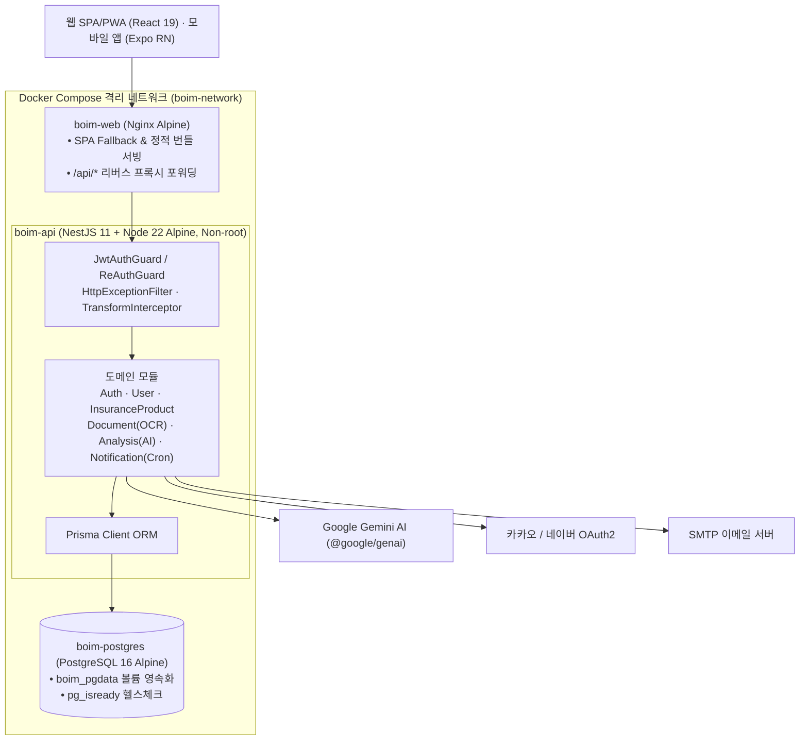

# ☂️ Boim (보임) — 프로젝트 기술 포트폴리오

> **"흩어진 내 보험, 한눈에 보임."**  
> 개인 보험 가입 현황 캘린더, 월 납입·만기 일정 자동 알림, 증권 OCR 자동 입력, Google Gemini AI 종합 보장 진단 및 리포트 내보내기를 제공하는 **모노레포 기반 풀스택 핀테크 플랫폼**입니다.

---

## 1. 📌 프로젝트 개요 (Project Overview)

| 항목 | 내용 |
| :--- | :--- |
| **프로젝트명** | **Boim (보임)** — 개인 보험 가입 현황 관리 캘린더 및 AI 진단 대시보드 |
| **아키텍처** | `pnpm` Workspace + `Turborepo` 기반 Full-Stack Monorepo (`web`, `api`, `mobile`, `shared-types`) |
| **개발 기간 / 단계** | **Phase 01 ~ Phase 21** 전 마일스톤 완수 (설계 · 구현 · 리팩토링 · 컨테이너화 · 실데이터 무결성 검증) |
| **주요 제공 형태** | 웹 SPA & PWA (`@boim/web`), 백엔드 API (`@boim/api`), 모바일 앱 (`@boim/mobile`), Docker Compose 풀스택 |
| **라이브 데모 / 저장소** | [Live Web Demo](https://park-intae.github.io/Boim/) · [배포 운영 가이드](./DEPLOYMENT.md) |

---

## 2. 🏗️ 시스템 아키텍처 & 모노레포 구조

### 2.1 모노레포 워크스페이스 구성
프론트엔드·백엔드·모바일 앱이 단일 진실 공급원(SSOT)을 공유하도록 4개의 워크스페이스로 모듈화했습니다.

- **`apps/web` (`@boim/web`):** React 19, Vite 8, TypeScript, Tailwind CSS, TanStack Query v5, Zustand, React Hook Form + Zod, Recharts, `oxlint`
- **`apps/api` (`@boim/api`):** NestJS 11, Prisma ORM 6, PostgreSQL 16, Passport/JWT, `@google/genai`, `tesseract.js`, `@nestjs/schedule`, `exceljs`, `nodemailer`
- **`apps/mobile` (`@boim/mobile`):** Expo SDK 58, React Native 0.88, React Navigation, `expo-camera`, `expo-file-system`
- **`packages/shared-types` (`@boim/shared-types`):** 전사 공통 DTO, API 응답 규격(`ApiResponse<T>`), AI 진단/OCR/소셜 연동 인터페이스

### 2.2 전체 시스템 아키텍처

### 2.3 데이터베이스 모델링 (`Prisma` + `PostgreSQL 16`)
- **`User`:** 로컬/소셜 통합 계정 모델 (`kakao*`, `naver*`, `local*` 프로필 필드, `primaryAccountProvider`, `preferredImageProvider`, `preferredNameProvider`, `isPassVerified`, `passCi`, 소프트 삭제 `deletedAt`)
- **`InsuranceProduct`:** 보험 상품 메타데이터 (`category`, `institution`, `startDate`, `maturityDate`, `monthlyPayment`, `coverageAmount(BigInt)`)
- **`Notification` & `UserNotificationSettings`:** 다중 채널 알림 이력(`in_app`, `email`, `push`, `kakao`) 및 사용자별 방해금지 시간(`quietHoursStart`/`End`) 설정
- **`Document`:** 업로드 증권 메타데이터, `Tesseract.js` 추출 원문(`ocrText`), 파싱 결과 JSON(`parsedData`)
- **`UserLoginHistory`:** 로그인 기기, IP 주소, 접속 위치 감사 로그

---

## 3. ⚙️ 핵심 비즈니스 엔진 및 기술 구현

### 3.1 Google Gemini AI & 규칙 기반 하이브리드 진단 엔진
- **실시간 AI 종합 진단 (`apps/api/src/analysis`):** 사용자의 가입 보험 포트폴리오(카테고리, 월 납입액, 보장금액)를 기반으로 `@google/genai` SDK를 호출해 종합 건강 점수(0~100점), 보장 등급(`EXCELLENT`~`WARNING`), 카테고리별 적정도, 강점·보완점·절약 팁을 구조화된 JSON으로 도출합니다.
- **무중단 Rule-based 안전 폴백 (`RuleBasedDiagnosisEngine`):** 외부 AI API 장애, 타임아웃 또는 할당량 초과 시 순수 도메인 규칙 엔진으로 자동 전환(`isFallback: true`)되어 100% 무중단 진단 응답을 보장합니다.
- **리포트 내보내기:** `exceljs`를 활용한 다중 시트 서식 Excel(`.xlsx`) 다운로드와 브라우저 `@media print` A4 최적화 PDF 인쇄를 지원합니다.

### 3.2 증권 OCR 스캔 & 정규식 패턴 매칭 엔진
- **웹·모바일 멀티 업로드 & OCR (`apps/api/src/document`):** `Multer`(최대 30MB)로 PDF/이미지/TXT 증권을 수신하고, `Tesseract.js`로 텍스트 레이어를 추출합니다.
- **보험사/상품 패턴 파서 (`DocumentParserService`):** 국내 주요 보험사명, 상품명, 증권 패턴, 납입 주기, 시작/만기일, 보장금액을 정규식으로 파싱해 프론트엔드 입력 폼에 원클릭 자동 입력(`Prefill`)합니다.
- **모바일 실시간 뷰파인더 스캐너 (`apps/mobile`):** `expo-camera` 기반 오토 스캐너로 촬영한 증권 이미지를 백엔드 OCR 파이프라인에 즉시 연동합니다.

### 3.3 자정 자동 스케줄러 배치 & 다중 채널 알림
- **크론 배치 스케줄러 (`@nestjs/schedule`):** 매일 자정(00:00 KST) `NotificationSchedulerService`가 납입 예정일(D-7, D-1) 및 만기 예정일(D-30, D-7, D-Day) 대상 상품을 집계합니다.
- **순수 판정 엔진 분리 (`NotificationRuleEvaluator`):** 당일 중복 발송 방지(Idempotency) 및 사용자별 방해금지 시간대 필터링을 순수 도메인 로직으로 분리해 테스트 용이성을 높였습니다.
- **다중 채널 어댑터:** In-App DB 알림, SMTP 이메일(`nodemailer`), 브라우저 푸시, 카카오 알림 채널을 지원합니다.

### 3.4 상용 소셜 OAuth2 & 1:N 계정 통합 보안 아키텍처
- **HMAC-SHA256 무상태 State 검증:** 카카오·네이버 공식 OAuth2 인가 리다이렉트 시 로그인 유저 JWT 기반 식별자와 10분 만료 HMAC 서명 `state`를 탑재해 CSRF 공격을 차단하고, 콜백에서 기존 계정에 소셜 프로필을 안전하게 바인딩합니다.
- **1:N 대표 본계정(Primary Account) 및 안전 롤백:** 로컬 계정과 카카오/네이버 계정을 다중 연동한 상태에서 대표 본계정 및 표시 프로필/닉네임 우선순위를 전환할 수 있으며, 대표 계정으로 지정된 SNS를 연동 해제할 경우 `local` 계정으로 자동 복구됩니다.
- **Row-level 접근 통제 & PASS 재인증:** 모든 API 조회/수정 쿼리에서 로그인 유저 소유권을 검증하며, 비밀번호 변경·계정 탈퇴 등 민감 작업에는 `ReAuthGuard`를 적용합니다.

---

## 4. 🎨 프론트엔드 & 모바일 UX/성능 최적화

- **3열 SPA 대시보드 & 공개 랜딩 페이지:** 비로그인 사용자에게는 정적 쇼케이스 목업과 3단계 인터랙티브 가이드를 제공하는 랜딩 페이지를, 로그인 사용자에게는 좌측 네비게이션·중앙 메인 뷰(캘린더/내 보험/보험료 분석/AI 진단)·우측 컨텍스트 패널로 구성된 3열 대시보드를 제공합니다.
- **상태 및 데이터 계층 명확화:** 서버 상태는 TanStack Query(Factory Pattern Query Key), UI 전역 상태는 Zustand, 폼 유효성 검사는 React Hook Form + Zod로 책임을 분리했습니다.
- **동적 청크 오류 자동 복구 (`RouteErrorBoundary`):** 라우트 단위 Dynamic Import 코드 스플리팅 환경에서 배포 직후 구버전 번들 해시 불일치로 청크 404가 발생하면 `sessionStorage` 플래그를 통해 1회 자동 새로고침을 수행해 런타임 크래시를 방지합니다.
- **PWA & 인쇄 최적화:** 오프라인 상태 감지 배너(`OfflineBanner`)를 제공하고, `@media print` 전용 스타일(`print:h-auto print:overflow-visible`)을 적용해 SPA 뷰포트 높이 제한으로 인한 PDF/인쇄 잘림을 해결했습니다.

---

## 5. 🛠️ 주요 트러블슈팅 및 엔지니어링 해결 사례

### Case 1. 컨트롤러 응답 이중 래핑 및 타입 메타데이터 충돌 해결
- **문제:** 백엔드 전역 `TransformInterceptor`가 모든 응답을 `{ success: true, data }`로 래핑함에도 개별 컨트롤러가 수동 래핑을 중복 수행해 프론트엔드에서 `.filter is not a function` 등 파싱 오류가 발생했고, `@boim/shared-types`의 순수 인터페이스를 일반 `import`로 불러와 NestJS 데코레이터 메타데이터(`TS1272`) 에러가 발생했습니다.
- **해결:** 컨트롤러는 순수 페이로드만 반환하고 예외는 `HttpExceptionFilter`로 일원화했으며, 프론트엔드 쿼리 훅 계층에 방어적 `unwrapResponse` 유틸을 도입했습니다. 또한 모든 순수 타입 임포트에 `import type`을 강제하고 `any` 타입을 전면 금지했습니다.

### Case 2. OCR 배경 노이즈 오인식 및 표(Table) 레이아웃 파싱 정밀화
- **문제:** `Tesseract.js`가 이미지 배경 노이즈를 영문 소문자(`aia SEs`)로 인식해 엉뚱한 보험사(`AIA생명`)로 오매칭하거나, 표 레이아웃의 깨진 영문 셀(`ae Sa -`)을 상품명으로 추출하는 문제가 있었습니다.
- **해결:** 영문 보험사 약어(`AIA`, `AXA`, `DB`, `KB` 등) 매칭에 단어 경계(`\b`)와 대소문자 구분을 적용하고, 한국 보험 상품명 고유 패턴(`무배당 / (무) ... 종합보험`) 우선 검출 및 최소 한글 2자 이상 검증 가드를 추가해 파싱 정확도를 확보했습니다.

### Case 3. Expo SDK 58 `expo/fetch` FormData 비호환 및 대용량 이미지 업로드 해결
- **문제:** 모바일 카메라로 촬영한 고해상도 증권 사진(12~18MB)이 백엔드 Multer 기본 제한(10MB)에 걸려 연결이 끊어졌고, Expo SDK 58의 WinterCG 표준 `expo/fetch`가 구형 React Native `{ uri, name, type }` 객체를 거부(`Unsupported FormDataPart implementation`)했습니다.
- **해결:** 백엔드 파일 업로드 허용 용량을 30MB로 상향하고 모바일 촬영 압축(`quality: 0.6`)을 적용했으며, `expo-file-system`의 정규 `File` 클래스를 도입해 표준 `FormData` 멀티파트 전송으로 규격화했습니다.

### Case 4. `pnpm` 모노레포 Docker 멀티스테이지 빌드 & Non-root 컨테이너 경량화
- **문제:** `pnpm` 워크스페이스의 심볼릭 링크 구조 때문에 호스트 디렉토리를 통째로 복사하면 빌드 시 `tsc` 모듈을 찾지 못하거나, 런타임 스테이지에서 `prisma generate`로 생성된 `@prisma/client`가 누락되는 문제가 발생했습니다.
- **해결:** 소스 파일만 선별 복사해 심볼릭 링크를 보존하고, `builder` 스테이지에서 컴파일된 `/app/node_modules` 및 `/app/apps/api/node_modules`를 함께 복사한 뒤 `NODE_PATH`를 명시했습니다. 또한 `apps/api` 런타임에는 Non-root(`USER node`) 권한 격리를, `apps/web`에는 `nginx:alpine` 정적 서빙을 적용해 보안을 강화했습니다.

### Case 5. Zero-Mock 프로덕션 실데이터 무결성 확립 (Phase 21)
- **문제:** 초기 개발 단계에 잔존하던 소셜 콜백 실패 시 임의 계정 자동 로그인 폴백, 테스트용 `temp_token`/`mock_state` 키, 가짜 소셜 연동(`mock-link`) 모드가 실사용 시 보안 및 데이터 정합성 위험을 유발할 수 있었습니다.
- **해결:** 비정상 자동 로그인 폴백과 모든 Mock 연동 코드를 전면 제거해 정식 에러 안내·재시도 UI로 전환했으며, 온보딩용 샘플 기능은 정식 `presetData` 규격으로 분리하고 대시보드 전 영역의 실데이터 바인딩 감사를 완료했습니다.

---

## 6. 📊 품질 보증(QA) 및 아키텍처 리팩토링 성과

### 6.1 전사 테스트 스위트 & 커버리지 현황
엄격한 TDD와 회귀 검증을 통해 모노레포 전체 테스트 통과율 100%를 유지하고 있습니다.

| 영역 | 프레임워크 | 테스트 규모 | 통과율 | 라인 커버리지 (최종 기록) |
| :--- | :--- | :---: | :---: | :---: |
| **Backend API (`@boim/api`)** | Jest / Supertest | **27 Suites · 205 Tests** | **100% PASS** | **90.22%** (Phase 14 기준) |
| **Frontend Web (`@boim/web`)** | Vitest / Testing Library | **48 Files · 211 Tests** | **100% PASS** | **83.15%** (Phase 14 기준, `src/api` 93.68%) |
| **전사 통합 (`pnpm test`)** | Turborepo | **75 Suites · 416 Tests** | **100% PASS** | 전사 품질 기준선(80%+) 달성 |

### 6.2 Clean Architecture 컴포넌트 및 도메인 규칙 엔진 분리 (Phase 14)
거대 컴포넌트와 서비스 파일에서 순수 비즈니스 로직·프레젠테이션·커스텀 훅을 분리해 단일 책임 원칙(SRP)을 확립했습니다.

| 분리 대상 | 분리된 모듈 / 훅 / 엔진 | 코드량 변화 |
| :--- | :--- | :---: |
| `RightPanel.tsx` | `DailyEventsView.tsx` | 252줄 ➔ **150줄 (-40%)** |
| `AiDiagnosisReport.tsx` | `DiagnosisScoreCard`, `CoverageProgressList`, `DiagnosisAdviceCards` | 347줄 ➔ **178줄 (-49%)** |
| `InsuranceForm.tsx` | `useInsuranceForm.ts` | 231줄 ➔ **125줄 (-46%)** |
| `ai-diagnosis.service.ts` | `rule-based-diagnosis.engine.ts` | 485줄 ➔ **184줄 (-62%)** |
| `notification-scheduler.service.ts` | `notification-rule.evaluator.ts` | 522줄 ➔ **291줄 (-44%)** |

### 6.3 DevOps & CI/CD 자동화
- **GitHub Actions CI (`.github/workflows/ci.yml`):** PR 및 Push 시 모노레포 린트, 단위/통합 테스트, 프로덕션 빌드 무결성을 자동 검증합니다.
- **GitHub Pages 배포 (`.github/workflows/deploy-pages.yml`):** 웹 데모 정적 빌드 및 자동 배포를 수행합니다.
- **Docker Compose 3-Tier 스택 (`docker-compose.yml`):** `boim-postgres` + `boim-api` + `boim-web`을 단일 명령(`docker compose up -d`)으로 로컬 및 상용 환경에 즉시 기동할 수 있습니다.
