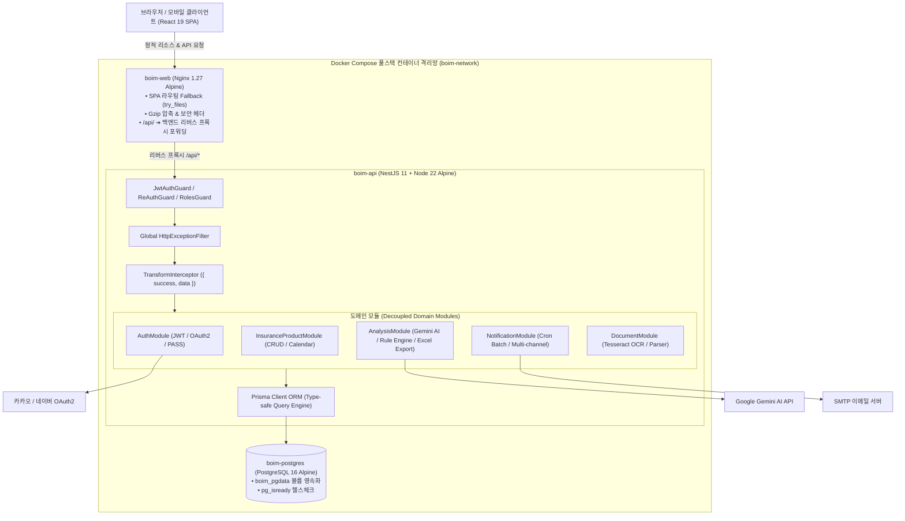
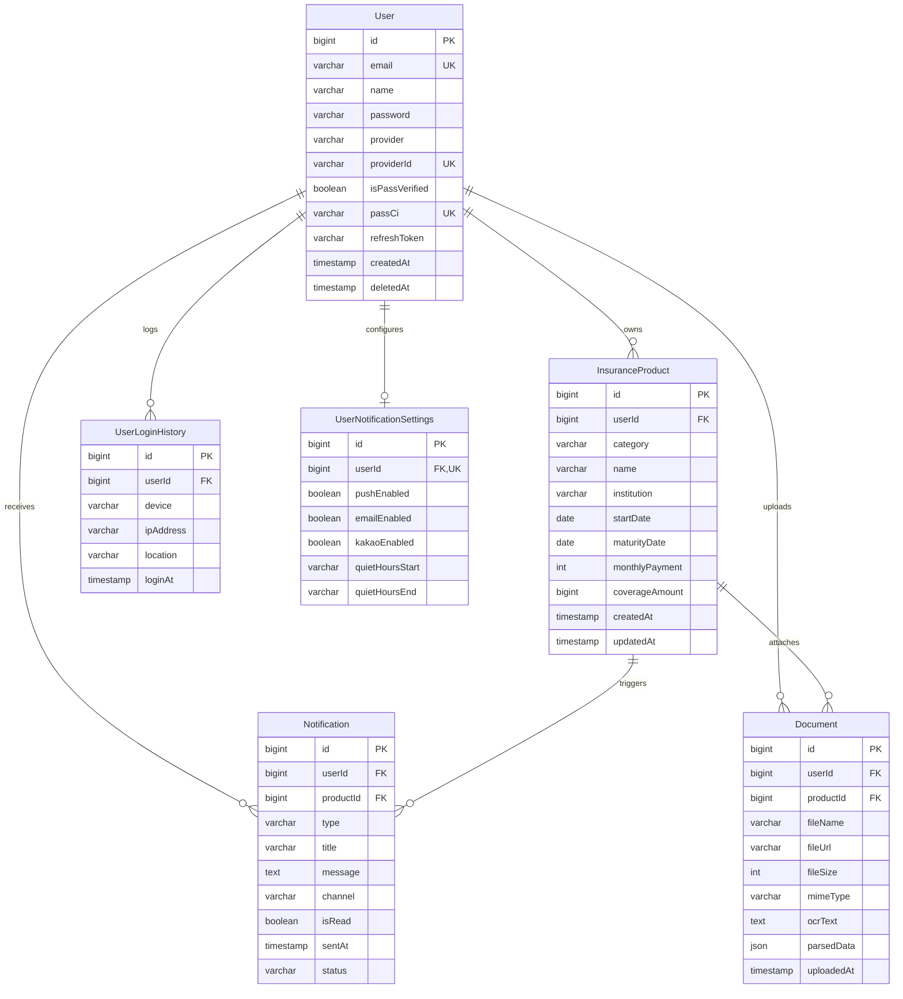

# ☂️ Boim (보임) - 프로젝트 종합 기술 해설서 (Project Technical Overview)

본 문서는 **Boim(보임)** 풀스택 프로젝트의 기획 배경, 전체 아키텍처, 도메인별 기능 구현 방식, 그리고 DevOps 및 품질 검증 체계를 총망라한 기술 문서입니다.

---

## 📌 1. 프로젝트 개요 및 기획 배경 (Context & Problem)

### 해결하고자 한 문제 (Problem)
대부분의 현대인들은 실손, 암, 종신, 운전자 등 여러 보험사(삼성화재, 현대해상, DB손해보험, 한화생명 등)에 분산된 보험을 가입해 두고 있습니다.
- **불투명한 지출:** 매달 총 얼마의 보험료가 언제 빠져나가는지 한눈에 파악하기 어렵습니다.
- **번거로운 계약 관리:** 종이 증권이나 PDF 파일 형태로 보관되어 있어 만기일이나 보장 내역을 일일이 기억하기 힘듭니다.
- **보장 공백의 위험:** 내가 가입한 보험이 내 연령대(3040 등) 기준에 맞게 적절히 설계되어 있는지, 과다하거나 부족한 보장은 없는지 진단받기 어렵습니다.

### Boim의 솔루션 (Solution)
1. **캘린더 기반 시각화:** 월별 납입 일정과 만기일을 캘린더 인터페이스로 통합 제공.
2. **증권 파일 자동 인식 (OCR & Rule Matcher):** 증권 사진이나 PDF를 업로드하면 텍스트를 추출하여 입력 폼에 원클릭 자동 입력(Prefill).
3. **자정 스케줄러 배치 & 다중 채널 알림:** 매일 자정 크론 배치를 통해 납입일(D-7, D-1) 및 만기일(D-30, D-7, D-Day)을 인앱/이메일/푸시로 사전 안내.
4. **Google Gemini AI 종합 진단:** 3040 표준 권장 기준 대비 종합 건강 점수(0~100점), 보장 등급 및 맞춤형 리모델링 조언을 제공하고 다중 시트 Excel(.xlsx) 및 원클릭 인쇄/PDF 저장 지원.

---

## 🏛️ 2. 시스템 아키텍처 및 모노레포 구조

### 모노레포 구성 (`pnpm workspace` + `Turborepo`)
- **`apps/web`:** React 19, Vite, Tailwind CSS, TanStack Query, Zustand, React Hook Form, Zod, Recharts, oxlint.
- **`apps/api`:** NestJS 11, Prisma ORM, PostgreSQL 16, Passport, JWT, bcrypt, Multer, Tesseract.js, `@nestjs/schedule`, `@google/genai`, `exceljs`.
- **`packages/shared-types`:** 프론트/백엔드 간 공유 DTO, 인터페이스, 공통 API 응답 규격(`{ success, data, error }`).
- **타입 무결성:** `any` 타입 지양, 엄격한 TypeScript strict 모드 적용.

---

## 🗄️ 3. 데이터베이스 모델링 (ERD)

---

## ⚙️ 4. 백엔드 핵심 기능 및 도메인별 구현 방식 (`apps/api`)

### 1) 인증 및 보안 인프라 (`src/auth/`, `src/user/`)
- **JWT + Refresh Token:** 무상태 인증 체계를 구축하고, DB에 안전하게 해시된 Refresh Token을 관리하여 안전한 세션 갱신을 지원합니다.
- **소셜 로그인 (카카오 / 네이버 공식 REST API):**
  - 인가 코드 승인, 토큰 교환 및 프로필 파싱 파이프라인 완성.
  - CSRF 공격을 방어하기 위해 `HMAC-SHA256` 서명이 포함된 10분 유효기간의 무상태 State 검증 적용.
- **PASS 본인인증 실감형 세션 파이프라인:** 6자리 암호화 난수 발급, 180초 TTL 카운트다운 타이머, 1회용 세션 검증 로직 구현.
- **민감 작업 재인증 (`ReAuthGuard`):** 비밀번호 변경, 계정 탈퇴, 알림 설정 변경 등 중요 API 호출 전 최근 15분 이내 비밀번호 재입력 여부를 검증.
- **Row-level 권한 통제:** 모든 데이터베이스 질의에 로그인된 본인의 `userId`를 강제 바인딩하여 타인의 정보 열람을 원천 차단.

### 2) 보험 관리 & 캘린더 엔진 (`src/insurance-product/`)
- 가입일(`startDate`), 만기일(`maturityDate`), 월납입액, 보장금액에 대한 완벽한 CRUD API 제공.
- 매월 납입일과 만기일을 실시간 계산하여 프론트엔드 월간 캘린더 셀과 동기화.

### 3) 증권 자동 분석 및 패턴 매칭 엔진 (`src/document/`)
- **Tesseract.js OCR:** 업로드된 이미지 및 PDF 파일에서 텍스트 레이어 정밀 추출.
- **`DocumentParserService`:** 국내 주요 보험사(삼성화재, 현대해상, DB손해보험, 한화생명 등)의 계약 패턴을 정규식으로 분석하여 보험사명, 상품명, 카테고리, 월납입액, 만기일을 구조화된 JSON으로 변환.

### 4) 자정 스케줄러 배치 & 다중 채널 알림 (`src/notification/`)
- **`NotificationSchedulerService` (`@nestjs/schedule`):**
  - 매일 자정(00:00 KST) 크론 배치를 통해 **월 납입일(D-7, D-1)** 및 **만기일(D-30, D-7, D-Day)** 도래 대상을 고속 집계.
  - **중복 발송 방지 (Idempotency):** 동일 날짜, 동일 상품에 대한 중복 알림 생성 원천 차단.
  - **방해금지 시간 필터링:** 유저 설정(`quietHours`) 시 야간 시간대 외부 발송 억제.
- **다중 채널 발송 어댑터:** DB 영속 인앱 알림, **Nodemailer SMTP 실발송 이메일**, Push, Kakao 모의 채널로 분기 발송.

### 5) AI 종합 진단 & 데이터 내보내기 엔진 (`src/analysis/`)
- **하이브리드 진단 엔진:**
  - **AI 모드:** Google Gemini 2.5 Flash 모델에 가입 현황을 프롬프트로 전달하여 0~100점 점수, 등급, 맞춤형 리모델링 조언 도출.
  - **Rule-based 엔진 폴백:** 외부 AI API 네트워크 장애 또는 할당량 초과 시 `RuleBasedDiagnosisEngine`이 즉각 가동되어 무중단 100% 정상 진단 보장.
- **ExcelJS 데이터 내보내기:** 가입 상세 시트, 카테고리별 통계 시트, AI 진단 요약 시트를 다중 시트 서식 적용 Excel(.xlsx) 파일로 스트리밍 생성.

### 6) 공통 인터셉터 및 에러 필터 (`src/common/`)
- `TransformInterceptor`: 모든 컨트롤러의 성공 응답을 `{ success: true, data: T }` 표준 포맷으로 자동 래핑.
- `HttpExceptionFilter`: 전역 예외 발생 시 마스킹 처리된 일관된 에러 응답(`{ success: false, error: { code, message } }`) 반환.

---

## 🎨 5. 프론트엔드 핵심 기능 및 아키텍처 (`apps/web`)

### 1) 반응형 SPA 3열 레이아웃 (`src/components/layout/`)
- **좌측 사이드바:** 대시보드, 내 보험, AI 리포트, 설정 메뉴 및 토스 스타일 로고(`BrandLogo`).
- **중앙 메인 영역:** 인터랙티브 월간 캘린더, 통계 지표 카드, Recharts 납입 분석 차트.
- **우측 슬라이딩 패널:** 날짜 클릭 시 당일 일정 상세(`DailyEventsView`), 보험 등록/수정 폼(`InsuranceForm`), 알림 리스트.

### 2) 상태 분리 전략 (서버 상태 vs 클라이언트 상태)
- **서버 상태 (TanStack Query):** 캘린더 데이터, 알림 목록, AI 진단 리포트 등 서버와 동기화되는 데이터는 React Query 캐시로 관리하며, 낙관적 업데이트(Optimistic Update) 및 자동 무효화(`invalidateQueries`) 적용.
- **클라이언트 상태 (Zustand):**
  - `authStore`: 기기 기억하기(Remember Me) 설정에 따라 `sessionStorage` / `localStorage`로 분기 저장되는 **하이브리드 토큰 스토리지** 구현.
  - `appStore`: 사이드바 토글, 우측 패널 모드(View/Create/Edit), 선택된 날짜 등 UI 인터랙션 관리.

### 3) 모던 핀테크 스타일 랜딩 페이지 (`src/features/landing/`)
- 비로그인 게스트 접속 시 첫인상을 결정하는 공개 랜딩 페이지.
- 순수 React 19 + CSS 인라인 SVG로 구현하여 무거운 이미지 없이 초고속 FCP 및 Retina 선명도 확보.
- 1~3단계(증권 자동 등록 ➔ 월간 납입 정리 ➔ AI 85점 진단 리포트) 탭 클릭 시 페이드 전환되는 인터랙티브 쇼케이스 목업 탑재.

### 4) 웹 성능 및 품질 최적화 (Phase 16)
- **청크 스플리팅:** `React.lazy` 및 Vite `manualChunks` 세분화로 메인 엔트리 번들을 **947.85 kB ➔ 88.01 kB (-90.7%)**로 극한 감축.
- **PWA & 오프라인 복원력:** `sw.js` 정적 캐싱, Network-First API 폴백, 오프라인 감지 배너(`OfflineBanner`) 구축.
- **웹 품질 100점 만점:** WAI-ARIA 접근성 속성 완비, Lighthouse 성능 96점 / 접근성 100점 / SEO 100점 달성.

---

## 🐳 6. DevOps & 인프라 오케스트레이션 (Phase 18)

1. **초경량 멀티스테이지 Dockerfile:**
   - 백엔드 (`apps/api/Dockerfile`): NestJS 11 + Prisma Client + Node 22 Alpine ➔ **293MB**.
   - 프론트엔드 (`apps/web/Dockerfile`): React 19 Vite 번들 + Nginx 1.27 Alpine ➔ **26.7MB**.
   - 웹 Nginx (`nginx.conf`): SPA 라우팅 Fallback, Gzip 압축, 보안 헤더 및 `/api/` ➔ 백엔드 컨테이너 리버스 프록시 연동.
2. **풀스택 Docker Compose (`docker-compose.yml`):**
   - `postgres:16-alpine` (healthy) ➔ `boim-api` (healthy) ➔ `boim-web` (port 80)
   - `docker compose up -d` 명령어 단 한 번으로 누구나 로컬에서 3대 서비스를 즉시 일괄 실행 가능.
3. **GitHub Actions CI 파이프라인 (`.github/workflows/ci.yml`):**
   - Push / PR 시 린트(oxlint/eslint), **전사 394개 테스트**, Turbo 빌드, Docker Buildx 이미지 패키징 자동 검증.
4. **GitHub Pages 자동 배포 (`.github/workflows/deploy-pages.yml`):**
   - 서브 경로(`/Boim/`) 및 SPA 404 리다이렉트 복원 스크립트(`404.html`)가 적용되어 **`https://park-intae.github.io/Boim/`**로 0원 웹 데모 상시 호스팅.
5. **상용 배포 가이드 및 보안 템플릿:**
   - `.env.production.example` (민감 키 100% 격리) 및 `docs/DEPLOYMENT.md` 완비.

---

## 📊 7. 종합 엔지니어링 성과 요약

| 지표 / 항목 | 달성 수치 및 결과 |
| :--- | :--- |
| **전사 테스트 무결성** | **74개 스위트, 394개 단위/통합 테스트 100% PASS** (Backend 192개 + Frontend 202개) |
| **타입 안정성** | `@boim/shared-types` 모노레포 공유 + Strict TypeScript 0 에러 |
| **프론트엔드 최적화** | 메인 번들 **-90.7% 감축 (88kB)**, Lighthouse a11y/BestPractices/SEO 100점 만점 |
| **인프라 패키징** | Docker Compose 원클릭 구동, Nginx 리버스 프록시(CORS 제로), GitHub Actions CI 완비 |
| **배포 이원화** | 채용 평가용 **GitHub Pages 웹 데모** + 실기동 검증용 **Docker Compose 풀스택** |
